# Project Outline

*Applied Programming · 2026-02 semester*

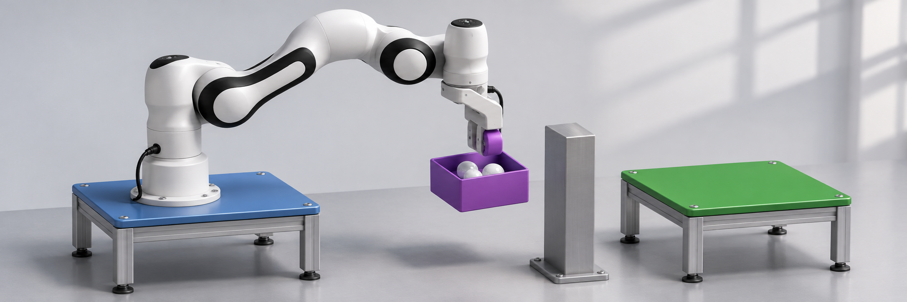

*Figure 1. Franka Emika Panda sample transport concept, based on the Genesis robot and container. Concept illustration.*

**Use this README for the complete assignment.** Follow the edit tasks, then the test and submission steps below. You do not need to read separate Markdown guides.

[1. Mission](#1-project-background-and-task) · [2. Conditions](#2-layout-and-design-conditions) · [3. Setup](#3-set-up-your-workspace) · [4. What to edit](#4-complete-the-three-design-tasks) · [5. Test and combine](#5-test-your-design) · [6. View your motion](#6-inspect-your-path-and-animation-optional) · [7. Results and submission](#7-results-leaderboard-and-submission) · [8. Assessment](#8-assessment) · [9. Help and updates](#9-troubleshooting-and-updates)

[Project Outline PDF](docs/project_outline_with_appendix.pdf) · [Public course template](https://github.com/SSUMechE/applied-programming-2026-term-project) · [Leaderboard](https://phoniness-reenact-veggie.ngrok-free.dev)

## 1 Project Background and Task

Physical AI connects computational decisions to physical action. In this project, a robot transports an open cup through a materials-processing cell while respecting equipment and sample constraints. Genesis evaluates how the planned motion affects the robot, container and contents.

Design robot placement, handoff locations, seven-joint paths and speed to reduce carrying distance and completion time. For the glass-bead stage, retain all **five original beads during every carry**. Supplied ideal handling resets them to prepared bead states between carries.

Complete the required transport tasks for the materials released for your selected complexity. **Glass beads are released first.** Additional materials will be released according to students’ progress.

Verify your own layout, path and timing with the supplied checks. Successful full bead missions can enter competition through the current rule. Final representative selection is separate from uploading a result. GTX 1660 SUPER runtime and memory remain unmeasured.

## 2 Layout and Design Conditions

### 2.1 Layout Examples

Compare team size, required handoffs and the **simulated** deadline before choosing a task.

| Complexity | CLI name | Students | Base maximum | Carrying arms / handoffs | Deadline |
| --- | --- | ---: | ---: | ---: | ---: |
| Lower | `easy` | 1 | 80 | 1 / 0 | 40 s |
| Moderate | `medium` | 1–2 | 90 | 2 / 1 | 85 s |
| Higher | `hard` | 2–3 | 100 | 3 / 2 | 105 s |

Lower has wide passages and alternative routes. Moderate adds staggered barriers and a low roof. Higher adds separated mounting regions, overhead obstacles and two handoffs.

The supplied scene parks unused robot models automatically. You choose placements only for the arms that carry the cup.

| Lower complexity | Moderate complexity | Higher complexity |
| --- | --- | --- |
| 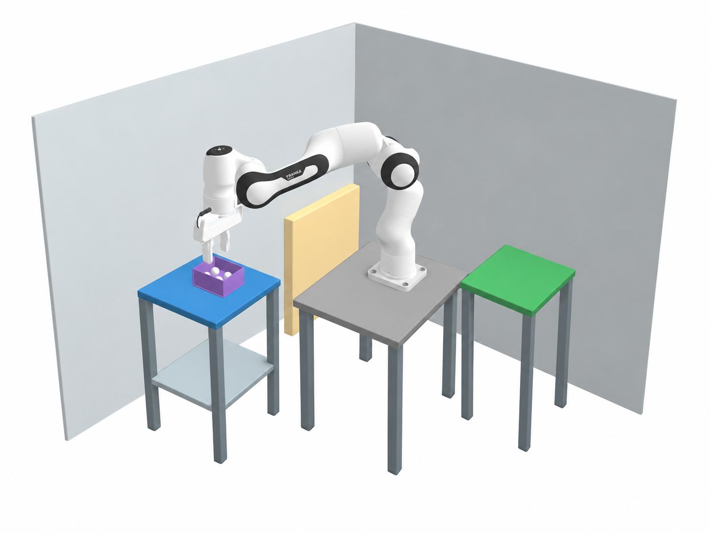 | 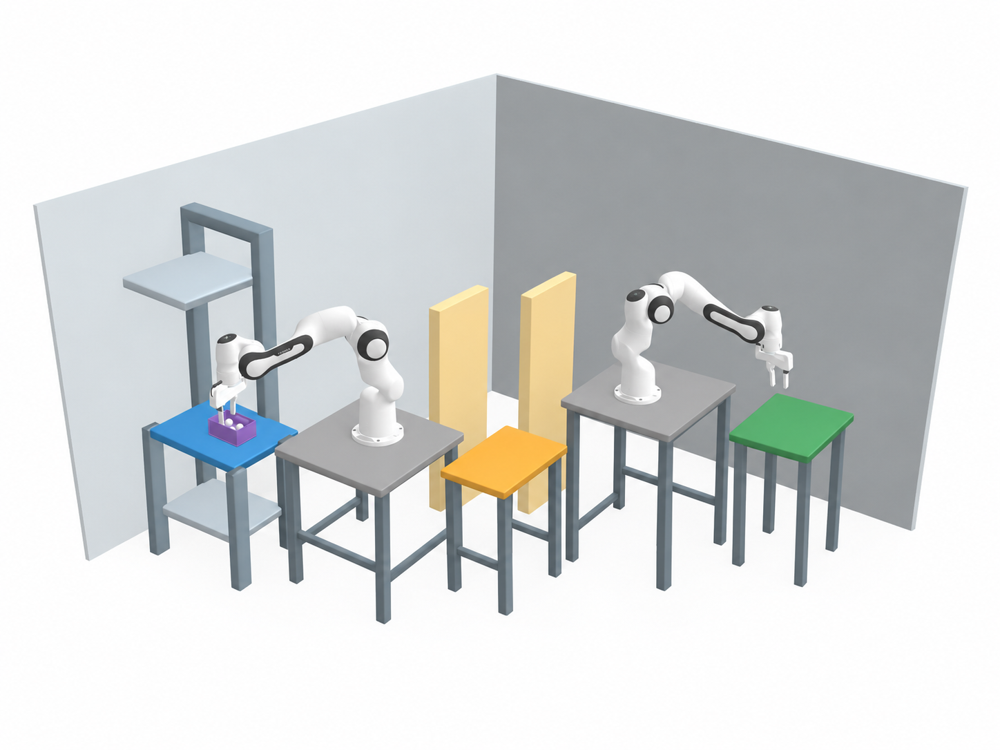 |  |

*Figure 2. Layout illustrations from the original Project Outline. See the [current map](docs/project-map-overview.png) and [3D viewer](docs/map_viewer.html) for exact geometry and permitted placements.*

Open `docs/map_viewer.html` from your cloned repository in Chrome or Edge. Keep its supplied JavaScript files beside it. Choose your complexity, then use **Preview your design JSON** to inspect selected bases and exact handoff points. Use **Preview your saved motion** to load your exported animation. **Stage**, **Frame** and **Play** show your motion. The **Planned cup path** or **Recorded cup path** checkbox shows the current stage's route. Use [Task 1](#41-task-1-fill-in-your-layout-json) to choose legal placements and [Section 6](#6-inspect-your-path-and-animation-optional) to view your own motion.

Use the materials marked **Open** for your current work.

| **Open** | **Closed**<br>To be updated | **Closed**<br>To be updated |
| :---: | :---: | :---: |
| 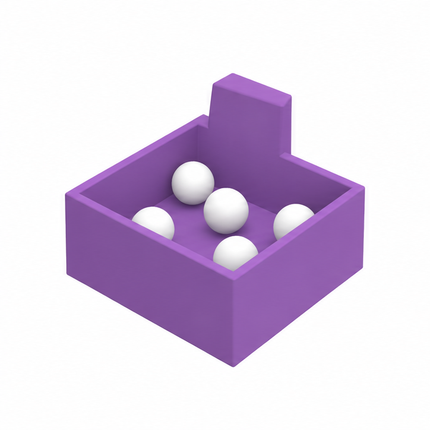<br>**Glass beads** | <br>**Aqueous solution** | 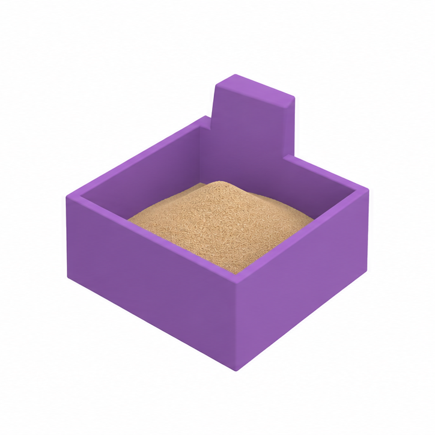<br>**Silica sand** |

*Original Project Outline concept illustrations. The glass-bead task uses five original beads.*

### 2.2 Design Inputs

**Student-designed inputs:** choose the carrying robots' placements, intermediate handoff locations and seven-joint paths. Choose motion speed within the given limits. In filenames, `<tier>` means `easy`, `medium` or `hard`. Replace editable JSON `null` values with your choices. A **base** is a robot's mounting location. A **handoff** is where one arm places the cup for the next arm. Lower needs **1 base and no handoff**, Moderate **2 bases and 1 handoff**, and Higher **3 bases and 2 handoffs**. The supplied code fixes the source, finish and unused-arm parking. Fill only the entries for your selected complexity in [Task 1](#41-task-1-fill-in-your-layout-json).

| Decision | Input and units | Edit location |
| --- | --- | --- |
| Robot placement | Mounting surface, X/Y in m, yaw in rad. Surface choice fixes height. | `student/<tier>_design.json` → `arms` |
| Handoffs | Existing support ID and cup reference point's **world X/Y in m**. Height and orientation are supplied. | Same JSON → `handoffs` |
| Joint path | A sequence of seven-angle configurations in rad | Your shared or selected arm strategy below → `plan_path` |
| Speed | `joint_speed_scale` in (0, 1], or one duration in seconds per path edge | Design JSON or `choose_edge_durations_s` |

In each `handoffs` entry, select an existing surface with `support_id`. Set the cup reference point with `x_m` and `y_m` in world metres, not offsets from the surface centre. The table stays fixed. Cup height and orientation are supplied.

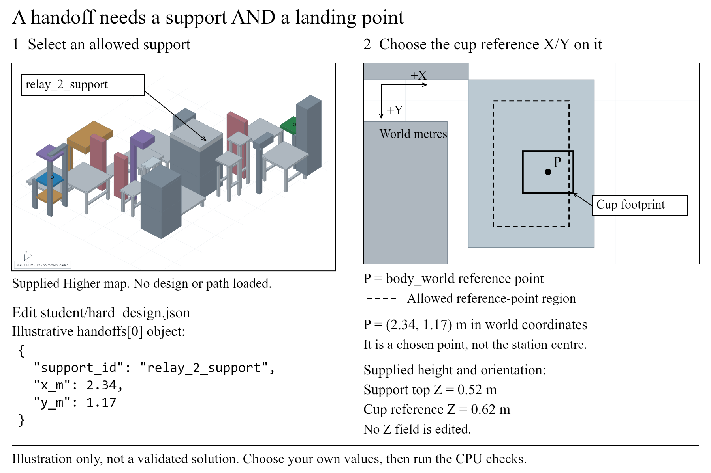

*P is an illustrative cup reference point. The dashed region limits P. Obstacles are faded for visibility only. Use the JSON fields and allowed-region lookup in [Task 1](#41-task-1-fill-in-your-layout-json).*

**Edit only the selected design JSON and your planner modules under `student/`.** [Tasks 1–3](#4-complete-the-three-design-tasks) identify the exact fields, function bodies and checks.

**Do not manually modify anything else supplied by the course. Unauthorized changes to supplied code or fixed data, or fabricated results, may receive ZERO for the project.** This includes planners outside `student/`, checkers, tests, physics, maps, limits, scoring rules and registration/recording code. Do not edit generated paths, logs or result receipts. Use the official updater for instructor-announced fixes. An authorized update is not a prohibited edit.

### 2.3 Your Implementation

Your `plan_path` function generates the intermediate seven-joint configurations between supplied start and goal. [Task 2](#42-task-2-implement-plan_path-and-return-your-path) shows where to return that path.

**Share the work by arm.** Moderate has two arm problems and Higher has three. Agree on one placement/handoff design, then each member can [plan and practice their own arm](#53-plan-and-practice-one-arm) before the other arms' code is ready. Use separate planner modules under `student/`, with the same `plan_path` interface. The supplied merger checks the saved paths and times without replanning them. Finish with one whole-scene bead review. Passing separate arm tests does not prove the full handoff sequence.


*Figure 3. The student planner constructs the route. A failed search returns None for revision.*

### 2.4 Provided Support

FK, IK, geometry/surface queries, full-robot collision checks, automatic grasp/release and interpolation are provided. [Task 2](#42-task-2-implement-plan_path-and-return-your-path) defines the calls and returns. FK and IK do not establish collision freedom.

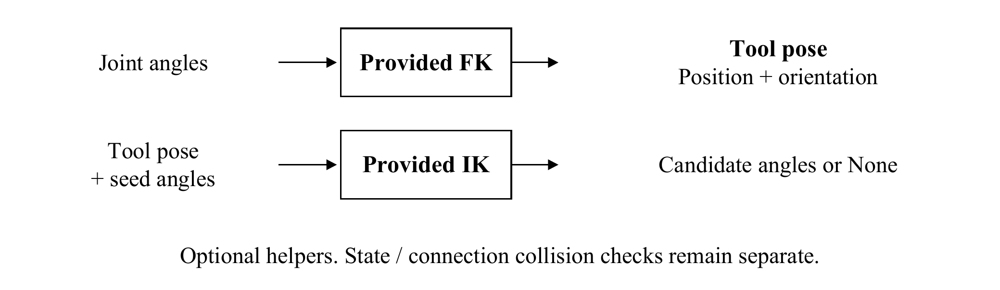

*Figure 4. Inputs and outputs of the supplied kinematics helpers. State and connection checks remain separate.*

You do not implement kinematics, a gripping controller, a physics solver or a test harness. Keep the supplied code unchanged. Your work is the planner and permitted design inputs in Section 2.2.

### 2.5 Fixed Conditions

**Instructor-fixed constraints:** joint-angle bounds, maximum joint velocity and acceleration/deceleration, and tracking tolerance are supplied. Keep these limits unchanged. You may impose stricter constraints in your own planner.

Keep the map, source/finish, robot, cup, material properties and five original bead IDs unchanged. **Bead physics and contacts run only during carrying.** Preparation, approach, automatic pick/place and released or handoff waits use prepared bead states. The supplied routine instantly resets bead positions and velocities and timestamps those resets. Students do not implement or edit this handling routine. Angles must stay within `request.bounds`. Collision checks include the robot, cup, obstacles and other arms.

**Provided motion control:** the supplied interpolator **accelerates and decelerates to rest at every waypoint**. Your path and edge durations change the commanded motion. They do not change the permitted limits. You do not implement a braking controller.

| Joints | Maximum absolute velocity | Maximum absolute acceleration/deceleration |
| --- | ---: | ---: |
| 1–4 | 1.0 rad/s | 2.0 rad/s² |
| 5–7 | 1.4 rad/s | 2.8 rad/s² |

Sampled process VRAM must stay within **5,000,000,000 bytes**. Missing measurements are not treated as zero. These instructor-fixed joint limits apply to commands and actual motion. Tracking error must stay within **0.03 rad**. Physics uses **0.0025 s** intervals and **16 internal substeps**. A legal command can still fail physical replay.

A spill during carrying immediately fails the run. All five original beads must pass the carry-end check before a place reset. A reset cannot replenish a missing bead or erase failure. Robot/cup physics, contact and support/rest checks continue throughout. Prohibited contact, control-limit violations or failed final support/rest also reject a run. There is no separate 8° spill gate or required slowdown multiplier.

After a handoff, the donor follows its reverse path kinematically with **zero physics time**. Only its final pose receives a contact check. This does not certify the return's swept collision freedom. The last carrier does not return.

### 2.6 Development Process

Treat a Genesis replay as a **virtual experiment**. Predict how a change in placement, path or timing will affect the motion, choose a suitable test, inspect its results, and revise your design. [Section 5](#5-test-your-design) gives the exact commands.


*Figure 5. Geometric checks establish route validity at the supplied resolution. Simulation reveals physical transport behavior.*

**Recommended first experiment: CPU geometry → empty cup → five glass beads.** First find a geometrically valid path on the CPU. Use an empty-cup Genesis experiment to check robot/cup motion, contact and automatic handling. Then replay the same saved path and timing with beads to test their motion and retention during carrying.

After the first comparison, target later experiments to the uncertainty you need to resolve. You do **not** need three full runs after every change. After editing the planner, layout, handoff or timing, export a fresh CPU plan before another physical experiment.

Team members can also [practice one arm in Genesis](#53-plan-and-practice-one-arm) using an empty cup or glass beads. These separate runs help diagnose each arm. Only the full bead mission can enter the leaderboard.

<a id="3-start-and-test-your-design"></a>

## 3 Set up your workspace

Use **Windows Anaconda Prompt**. Copy only the commands inside the code blocks, without terminal prompts or printed output. Run them from your team repository root, in the order below. Copy a complete command block. A trailing `^` continues the same command on the next line in Anaconda Prompt. Do not add spaces after `^`.

### 3.1 Create and clone your team's repository

On GitHub, choose **Use this template → Create a new repository**. Create **one private repository for your individual or team project**. Use the same name for this GitHub repository and your leaderboard account:

- **One student:** use your student ID only, such as `20260001`. This applies to a solo Lower or Moderate project.
- **Two or three students:** put all members' student IDs in ascending order, joined with `-`, such as `20260001-20260002`. Everyone uses this one shared repository and leaderboard name. Do not invent a separate nickname.

These are naming examples, not IDs to copy. Add **SSUMechE** and, for a group, every teammate as collaborators. Your usual weekly-assignment repository names do not change. Clone your private project repository, not the public course template:

```bat
cd /d "%USERPROFILE%"
set /p "TEAM_REPO_URL=Paste your private team repository URL: "
git -c core.longpaths=true clone "%TEAM_REPO_URL%" ap2026-team
cd ap2026-team
conda activate applied-programming-cuda
```

Continue only after cloning and environment activation succeed. `ap2026-team` is only the local folder name used by these commands. It is not your GitHub repository or leaderboard name. If you already have this project checkout, open its folder and activate the environment instead of cloning again. Use a different local folder for another project.

Each member must commit and push their own work using their own GitHub account. Keep design files, saved paths and motion previews in the private team workspace.

### 3.2 Register your team and check the environment

Use the student-ID name from [3.1](#31-create-and-clone-your-teams-repository) as your **Team name**, even when working alone. Choose a project password of at least **12 characters**. Group members share that password. Then run:

```bat
python -B project_run.py check --cuda --output output/environment.json
```

At first use, enter that student-ID name and password when prompted. Use a project-specific password, not your GitHub password. Type it only at the hidden password prompt. Each teammate uses the same pair once per checkout on each computer.

If this checkout already has a registered name, this instruction does not rename it. Keep its existing results and contact the instructor if the name is wrong. Do not create a second account or delete credentials to rename it.

On your first successful sign-in, confirm these results:

- `TEAM_CONNECTED: <your team name>`: this checkout is connected to your team.
- `ENVIRONMENT_CUDA_SMOKE_PASS`: the environment and short CUDA checks passed.

The client stores this computer's credential outside Git and reuses it automatically. Later checks do not repeat the sign-in prompt or TEAM_CONNECTED message. Each environment check must still report ENVIRONMENT_CUDA_SMOKE_PASS. No instructor-issued token, ngrok or VPN installation is required. If saved sign-in is refused, run `python -B project_run.py configure` and re-enter the same team password.

Keep **PyTorch 2.14.0+cu126** and **Genesis 1.3.2**. On an environment mismatch, preserve the output and wait for instructor guidance before changing packages. If sign-in is unavailable, local work can continue. Use [upload recovery](#72-retry-an-upload-without-repeating-physics) after reconnecting.

### 3.3 Choose your complexity and output folder

Copy **one** block. These variables last only in the current prompt window. The CLI names `easy`, `medium` and `hard` correspond to Lower, Moderate and Higher complexity.

**Lower complexity**

```bat
set "LEVEL=easy"
set "MAP=easy_open_v1"
set "RUN=output\lower_01"
```

**Moderate complexity**

```bat
set "LEVEL=medium"
set "MAP=medium_staggered_v1"
set "RUN=output\moderate_01"
```

**Higher complexity**

```bat
set "LEVEL=hard"
set "MAP=hard_industrial_v1"
set "RUN=output\higher_01"
```

For each revised attempt, choose a fresh `RUN`, such as `output\higher_02`. Keep earlier results. When reopening the prompt, return to your team repository folder, activate the environment and set these variables again.


<a id="34-implement-your-planner-and-design"></a>
<a id="35-export-your-cpu-checked-path"></a>

## 4 Complete the three design tasks

**Write only the permitted design JSON and your planner code under `student/`.** The three tasks below produce the layout, seven-joint path and timing used by the supplied validator. Keep the other course files and generated results unchanged.

### 4.1 Task 1: Fill in your layout JSON

**Edit:** `student/easy_design.json`, `student/medium_design.json` or `student/hard_design.json`, matching `LEVEL` from Section 3.3. Replace every editable `null` in that file. For team work, agree on this one shared design before planning separate arms.

Use this table to identify exactly what your file requires.

| Your complexity | Robot entries to complete | Handoff entries to complete | Supplied final destination |
| --- | --- | --- | --- |
| Lower | `arm_0` | None. Keep `handoffs: []`. | `relay_1_support`, XY `(1.02, 1.04)` m |
| Moderate | `arm_0`, `arm_1` | `handoffs[0]` | `relay_2_support`, XY `(2.35, 1.02)` m |
| Higher | `arm_0`, `arm_1`, `arm_2` | `handoffs[0]`, `handoffs[1]` | `goal_support` |

Every task starts at the supplied `source_support`. A support named `relay_1_support` is Lower's finish, not an extra handoff. Do not enter the fixed source, finish or unused arms in your JSON. Keep the supplied schema, difficulty, arm IDs and entry counts.

**Find allowed values first.** After setting `MAP`, run this supplied lookup from the repository root. It reads the map without starting Genesis.

```bat
python -B -c "import json,os; from pathlib import Path; from transport_challenge.three_arm_design import design_space; w=json.loads((Path('cases/difficulty_20261106')/os.environ['MAP']/'world.json').read_bytes()); print(json.dumps(design_space(w),indent=2))"
```

In the printed result, `mount_regions` gives mounting IDs, XY/yaw bounds and heights. `relay_regions` gives permitted support IDs, cup XY bounds and heights. Use those IDs and bounds when filling these fields:

| Edit this field | Write this value |
| --- | --- |
| `arms[i].mount_region` | An allowed mounting-surface ID |
| `arms[i].base_placement.x_m`, `y_m` | The base's world X/Y in metres, inside that region |
| `arms[i].base_placement.yaw_rad` | Base direction in radians, inside that region's bounds |
| `handoffs[i].support_id` | An allowed existing support for that transfer |
| `handoffs[i].x_m`, `y_m` | The cup body origin's world X/Y in metres |
| `joint_speed_scale` | A value in `(0, 1]`, explained in Task 3 |

For example, this is **one handoff entry's syntax**, not a complete design or a verified solution:

```json
{
  "support_id": "relay_2_support",
  "x_m": 2.34,
  "y_m": 1.17
}
```

The coordinates move the cup's landing target, not the table. They are not offsets from the table centre. The selected support supplies cup Z and orientation. The mounting surface supplies robot height, including the fixed 1 mm mounting clearance. Do not add arbitrary base Z or handoff Z/yaw fields.

Choose distinct permitted handoff supports, excluding your tier's fixed finish. The catalogue includes relay and quality supports. Permission to use a surface does not guarantee that both neighbouring arms can reach it. Published cup XY bounds account for its footprint. CPU checking also requires the bottom corners to stay at least `context.query_tracking_clearance_m` inside the support edges, currently 0.004 m. Leave that margin instead of choosing the exact boundary.

**Inspect:** open `docs/map_viewer.html` locally in Chrome or Edge, select your complexity and load the edited JSON through **Preview your design JSON**. Confirm your base origins and the exact handoff points shown in Figure 2's map and the handoff illustration above. This preview is not a collision or reachability pass. The CPU plan in Section 5 performs those checks.

### 4.2 Task 2: Implement `plan_path` and return your path

**Choose your edit file.** You may use one shared planner for all active arms, or split implementation by arm.

| Arrangement | Edit | Check in Section 5.1 |
| --- | --- | --- |
| One shared planner | `student/joint_strategy.py` | `test` |
| Separate arm planners | `student/arm_0_strategy.py`, `arm_1_strategy.py` or `arm_2_strategy.py` for your assigned arm | `test-arm` |

For separate work, set `ARM` to your assigned arm and copy the starter only if that file does not exist:

```bat
set "ARM=arm_0"
if not exist "student\%ARM%_strategy.py" copy "student\joint_strategy.py" "student\%ARM%_strategy.py"
```

For `ARM=arm_1`, edit `student/arm_1_strategy.py`, and likewise for `arm_2`. Other members' planners and the shared starter may remain unfinished. Everyone uses the same layout JSON and instructor release. Helpers you write must also stay under `student/`.

**Edit the body of `plan_path` at `BEGIN REQUIRED STUDENT EDIT`.** Replace the supplied `raise NotImplementedError(...)` with your search and its return. Keep this signature:

```python
def plan_path(request, oracle, *, kinematics=None, context=None):
```

Use RRT, bidirectional RRT, A*, or another suitable taught method to find intermediate seven-joint configurations. Recover them in start-to-goal order. **The returned list or tuple is where you give your path to the validator.**

The following shows the successful return shape. `q_a` and `q_b` stand for two seven-angle tuples computed by your algorithm. They are not supplied variables or prescribed waypoints. Your actual path may have a different number of intermediate states.

```python
# At the end of a successful search inside plan_path:
path = (request.start, q_a, q_b, request.goal)
return path
```

Each state is `(joint1, joint2, joint3, joint4, joint5, joint6, joint7)` in **radians**, not an XYZ point. Return `None` when no path is found. Do not manually edit the saved path JSON. The runner validates your return, applies Task 3's times and saves that exact motion for replay.

Use the supplied objects below while constructing your path. Start and goal are the only prescribed configurations.

| Supplied input or call | Meaning and result |
| --- | --- |
| `request.start`, `request.goal` | Exact seven-angle endpoint tuples, rad |
| `request.bounds` | Seven inclusive `(lower, upper)` joint intervals, rad |
| `request.seed`, `request.max_queries` | Sampling seed and shared state/edge query budget |
| `oracle.state_valid(q)` | Boolean validity of your proposed seven-angle state |
| `oracle.edge_valid(a, b)` | Boolean sampled validity of the straight joint-space connection between two states |
| `oracle.queries_used`, `oracle.remaining_queries` | Used and remaining validity calls |
| `context.active_arm_id`, `context.motion_kind` | The selected arm and either `approach` or `carry` |
| `kinematics.fk(q)` | `ToolPose` with world `position_m` and unit `quaternion_wxyz` |
| `kinematics.ik(position_m, quaternion_wxyz, seed_q)` | Seven candidate angles or `None` |

For each arm, the supplied endpoint calculation defines an approach request and a carrying request. Implement both through this same interface. FK/IK and automatic pickup/placement are provided. An IK result still needs state and edge checks. Valid endpoints alone do not make their connection valid. Check joins and shortcuts too.

Your return must satisfy all of these conditions:

- First state equals `request.start` exactly and last state equals `request.goal` exactly.
- Every state contains seven finite angles inside their native bounds. Do not clip or wrap them.
- No adjacent duplicate states. For equal valid endpoints, return `(request.start,)`.
- At most 10,000 returned states. This storage cap is separate from search-tree size.
- Every returned state and edge must pass the supplied final validation. You can use finer connection sampling or stricter constraints, but cannot weaken that final check.

Each public state or edge call consumes one query, including rejection. Exhaustion raises the supplied `PlanningBudgetExceeded`. Handle search failure by returning `None`. The default is 50,000 validity queries per stage. Computer elapsed time has no automatic cutoff. A failed search is a result to investigate, not permission to change the checker.

**Use the provided 3D geometry for clearance.** The case's `world.json` contains the obstacle boxes, support geometry and cup geometry. You do not estimate coordinates from a picture. In your planner, `context.nominal_obstacles` gives each `obstacle_id`, `lower_m` and `upper_m` as world XYZ coordinates in metres. For a candidate seven-angle state `q`, call:

```python
surfaces = kinematics.geometry(q)
```

`surfaces` contains the robot, cup, other arms and map collision geometry at that state. Use it for your own distance, clearance or additional constraint. Keep the full-robot state and edge checks, since tool-only clearance can miss an elbow or cup. Joint-space `distance(a, b)` and `steer(a, b, step)` use radians. Physical clearance uses metres.

<details>
<summary>Geometry fields and query diagnostics for your implementation</summary>

Each immutable `WorldGeometry` record provides `geometry_id`, `owner_kind`, `entity_id` and `link_id` for identity. `shape`, `center_m` and `quaternion_wxyz` describe its world shape and pose. `vertices_m` and `triangles` contain mesh/box vertices and triangle indices. `half_extents_m` or `radius_m` describe boxes or spheres when applicable. `surface_points_m` contains samples, not a complete curved surface. `query_aabb_m` contains separate padded bounds when used by the oracle. A plane has infinite extent and a local +Z normal.

Robot records use installed collision meshes. Map boxes expose nominal surfaces. The held cup follows the supplied grasp transform, and peers retain their stage poses. This query performs no physical step. It consumes one shared FK call. Check `kinematics.remaining_fk_calls` and `kinematics.remaining_ik_calls` before optional geometry/FK/IK calls. These helpers do not certify collision freedom.

`context` also supplies `joint_names`, `joint_limits`, `base_placement`, `fixed_base_z_m`, `workspace_bounds_m`, `start_tool_pose`, `goal_tool_pose`, `source_support_id`, `destination_support_id`, `query_tracking_clearance_m` and `edge_max_joint_delta_rad`. It contains no intermediate route.

After rejection, `oracle.last_query_diagnostic()` returns a detached reason/contact record without consuming another query. Read `reason` and `witness_status` before interpreting contact points or normals. A successful query clears the previous failure information. Sampled geometry is not a proof of continuous collision freedom or bead retention.

</details>

### 4.3 Task 3: Choose speed or individual edge times

**Option A — edit the JSON only.** Set `joint_speed_scale` in your selected design JSON to `(0, 1]`. Leave `choose_edge_durations_s` returning `None`. The supplied interpolator divides each edge's analytic minimum time by this scale. For example, `0.5` gives twice the minimum time for the same edge. Smaller values slow the command and reduce its acceleration.

**Option B — edit `choose_edge_durations_s` in your selected planner file.** Use `BEGIN OPTIONAL STUDENT EDIT`. Set the shared JSON scale to `1.0`, and add `--edge-timing-hook` to the CPU planning command. Each arm can return its own timing through its own module.

The function receives your validated `path` and fixed `limits`. Return **one finite positive time in simulated seconds per edge**, so there are `len(path) - 1` values. Each must be at least `minimum_edge_duration_s(a, b, limits)`. A one-state path uses `()`. Returning `None` keeps the JSON scale.

This optional example assigns twice the minimum time to every edge. It illustrates the interface, not a required slowdown or a physical success guarantee. The helper is already imported in the starter.

```python
def choose_edge_durations_s(path, limits, *, context):
    return tuple(
        2.0 * minimum_edge_duration_s(a, b, limits)
        for a, b in zip(path, path[1:])
    )
```

Invalid times are rejected, not stretched. Do not combine explicit times with a JSON scale below `1.0`. Provided quintic interpolation accelerates and decelerates to rest at every waypoint. More waypoints can add stops. You design the path and times, not the timestep or braking controller. A command within the limits can still fail physical tracking, contact or sample retention.

## 5 Test your design

Use the supplied tests and runners. You do not write a test harness or verification report. **CPU planning → empty-cup experiment → five-bead experiment** is the recommended first comparison. Afterwards, choose focused tests for the uncertainty you want to resolve rather than repeating every full experiment.

| CPU geometry | GPU: empty cup | GPU: five glass beads |
| :---: | :---: | :---: |
| 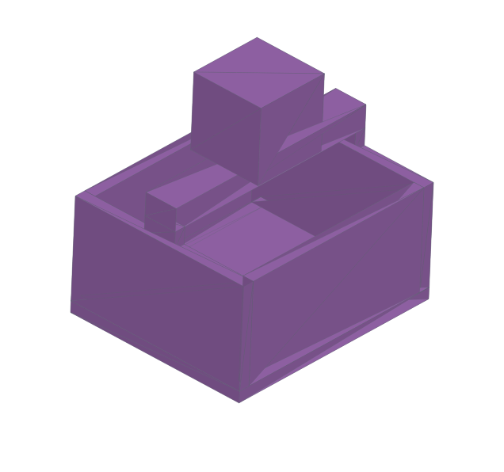 |  | 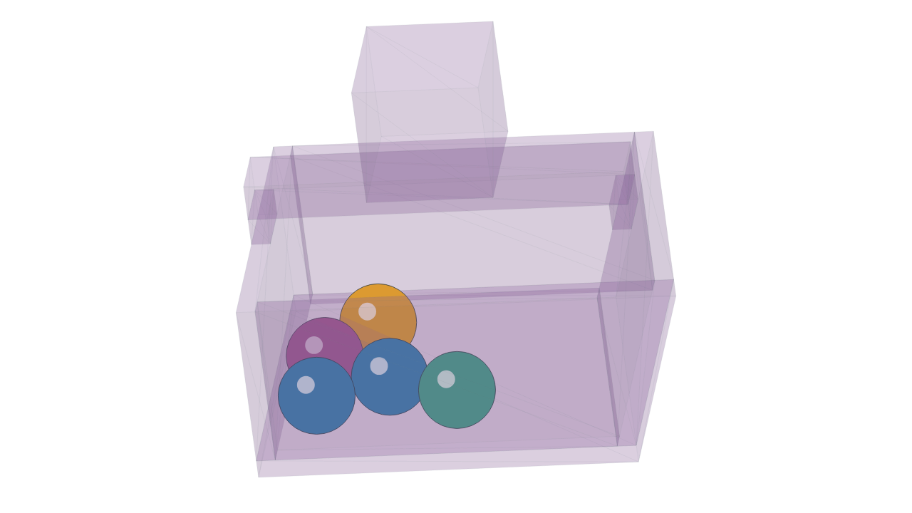 |
| Check your configurations, connections and clearance. No physical integration. | Experiment with tracking, contacts and automatic handling. No bead dynamics. | Add physical bead motion, contact, spill and retention checks during carrying. |

*Figure 6. CPU geometry and recorded Genesis carrying views. The bead image is from an earlier authenticated five-bead experiment and illustrates the mode, not a new-release qualification. Compare your own runs with the same saved path and times.*

### 5.1 Run the supplied interface checks

After completing Tasks 1–3, run **one** test command for your arrangement.

For the shared `student/joint_strategy.py`:

```bat
python -B project_run.py test
```

For your selected `student/%ARM%_strategy.py`:

```bat
python -B project_run.py test-arm --strategy student.%ARM%_strategy --arm %ARM%
```

**Expected:** all three interface checks pass. The unfinished starter intentionally has two path errors and one passing default timing check. These toy-geometry checks verify the interface, not workcell feasibility. Complete your implementation if they fail.

**Choose your next route:** a shared planner handling every active arm goes to 5.2. Independent arm work goes directly to 5.3, then combines at 5.4. Both routes finish with 5.5.

### 5.2 Export a complete CPU plan with one shared planner

Use this command when `student/joint_strategy.py` handles all required arms:

```bat
python -B project_run.py plan --scope tier-mission --difficulty %LEVEL% --material beads ^
  --task cases/difficulty_20261106/%MAP% --design student/%LEVEL%_design.json ^
  --strategy student.joint_strategy --output "%RUN%/cpu"
```

**Expected:** `CPU_GEOMETRIC_TIER_MISSION_PLANNED` and `%RUN%/cpu/saved_tier_mission.json`. It stores your exact paths, times, layout and source identities. Continue to 5.5. For explicit Task 3 times, append `--edge-timing-hook`. Keep `--material beads` even if the next experiment uses an empty cup. Replay selects contents separately.

### 5.3 Plan and practice one arm

**Use this route for separate arm work.** The other arm modules may be absent or unfinished. `ARM` selects your arm and `--strategy` names its Python module, without `.py`.

```bat
python -B project_run.py plan-arm --difficulty %LEVEL% ^
  --task cases/difficulty_20261106/%MAP% --design student/%LEVEL%_design.json --arm %ARM% ^
  --strategy student.%ARM%_strategy --output "%RUN%/cpu_%ARM%"
```

**Expected:** `CPU_GEOMETRIC_ARM_MISSION_PLANNED` and `%RUN%/cpu_%ARM%/saved_arm_mission.json`. Keep that entire output folder and its accompanying identity files. Only this arm's approach and carry are planned. For explicit Task 3 times, append `--edge-timing-hook`.

Run an empty-cup experiment first, then a bead experiment when ready:

```bat
python -B project_run.py practice --saved-arm "%RUN%/cpu_%ARM%/saved_arm_mission.json" ^
  --difficulty %LEVEL% --task cases/difficulty_20261106/%MAP% ^
  --design student/%LEVEL%_design.json --arm %ARM% --contents empty ^
  --output "%RUN%/practice_%ARM%_empty"
python -B project_run.py practice --saved-arm "%RUN%/cpu_%ARM%/saved_arm_mission.json" ^
  --difficulty %LEVEL% --task cases/difficulty_20261106/%MAP% ^
  --design student/%LEVEL%_design.json --arm %ARM% --contents beads ^
  --output "%RUN%/practice_%ARM%_beads"
```

These experiments replay your saved approach, automatic pickup, carrying, automatic placement and rest. Base placements, handoff points, other robots and collision geometry remain present. The cup starts on your arm's source support and the other arms use the shared home commands. Later-arm practice does not physically execute an earlier arm's handoff.

Read `PRACTICE_RESULT.json` in the chosen output folder. **Expected:** `ARM_PRACTICE_PASS`. On failure, read `failure` and `failed_checks`, revise the relevant student input and create a fresh CPU export. A practice pass stays local and cannot rank, even if every arm passes separately.

<details>
<summary>Already have a complete CPU plan? Practice one arm from it</summary>

Set `ARM` to an active arm for your complexity, then use the same full plan without planning it again:

```bat
python -B project_run.py practice --saved-tier "%RUN%/cpu/saved_tier_mission.json" ^
  --difficulty %LEVEL% --task cases/difficulty_20261106/%MAP% ^
  --design student/%LEVEL%_design.json --arm %ARM% --contents empty ^
  --output "%RUN%/practice_%ARM%_empty"
python -B project_run.py practice --saved-tier "%RUN%/cpu/saved_tier_mission.json" ^
  --difficulty %LEVEL% --task cases/difficulty_20261106/%MAP% ^
  --design student/%LEVEL%_design.json --arm %ARM% --contents beads ^
  --output "%RUN%/practice_%ARM%_beads"
```

Other robots retain the saved boundary commands for that stage. The same local-only practice limits apply. Keep these output names fresh.

</details>

### 5.4 Combine independently planned arms

For Moderate, `arm_0` carries source → first handoff and `arm_1` carries handoff → finish. Higher adds `arm_1` between two handoffs and `arm_2` from the second handoff to finish.

Before merging, bring the producing files and plan folders together:

1. Each member commits and pushes their own planner and helpers to the **same private team repository**, using their own account. Bring those exact source files into the checkout that will run the full mission.
2. Use the same completed design JSON and supplied release for every arm.
3. Privately copy each **complete CPU output folder**, including its identity files, into `%RUN%/cpu_arm_0`, `%RUN%/cpu_arm_1` and, for Higher, `%RUN%/cpu_arm_2`. Git excludes `output/`, so pushing source code does not transfer these folders. A private ZIP transfer is suitable. Do not edit the generated contents.

For Moderate:

```bat
python -B project_run.py merge-arms --difficulty %LEVEL% ^
  --task cases/difficulty_20261106/%MAP% --design student/%LEVEL%_design.json ^
  --arm-plans "%RUN%/cpu_arm_0/saved_arm_mission.json" ^
  "%RUN%/cpu_arm_1/saved_arm_mission.json" --output "%RUN%/cpu"
```

For Higher:

```bat
python -B project_run.py merge-arms --difficulty %LEVEL% ^
  --task cases/difficulty_20261106/%MAP% --design student/%LEVEL%_design.json ^
  --arm-plans "%RUN%/cpu_arm_0/saved_arm_mission.json" ^
  "%RUN%/cpu_arm_1/saved_arm_mission.json" "%RUN%/cpu_arm_2/saved_arm_mission.json" ^
  --output "%RUN%/cpu"
```

For Lower using an independent `arm_0` module:

```bat
python -B project_run.py merge-arms --difficulty %LEVEL% ^
  --task cases/difficulty_20261106/%MAP% --design student/%LEVEL%_design.json ^
  --arm-plans "%RUN%/cpu_arm_0/saved_arm_mission.json" --output "%RUN%/cpu"
```

**Expected:** the merger creates `%RUN%/cpu/saved_tier_mission.json` after checking matching layout, endpoints, sources, limits, collisions and times. It does not call RRT or IK, move waypoints or retime your motion. Incompatible inputs are rejected. This is a complete CPU plan, not a physical pass. Continue to 5.5. Transfer folders are not an extra LMS submission.

<a id="36-optionally-check-with-an-empty-cup"></a>
<a id="36-start-physical-experiments-with-an-empty-cup"></a>
<a id="37-verify-the-full-glass-bead-mission"></a>

### 5.5 Experiment with the complete mission

Both the shared-plan and merged-plan routes now use `%RUN%/cpu/saved_tier_mission.json`. Keep all bound planner, design and supplied files unchanged during replay. The replay does not rerun RRT/IK or silently change your times.

**Optional full empty-cup experiment:** use it to check robot/cup motion, contacts and actual handoffs before adding beads. If your focused experiments already answer that question, continue to the full bead run below. Separate arm practice does not replace that final bead run.

```bat
python -B project_run.py review --saved-tier "%RUN%/cpu/saved_tier_mission.json" ^
  --difficulty %LEVEL% --task cases/difficulty_20261106/%MAP% ^
  --design student/%LEVEL%_design.json --contents empty --output "%RUN%/empty"
```

**Expected:** in `%RUN%/empty/REVIEW_SUPERVISOR.json`, `review_accepted` and `empty_mission_passed` are `true`. `full_mission_passed` remains `false`, as expected for an empty cup. This result cannot rank.

**Five beads:** this is the full mission used for competition.

```bat
python -B project_run.py review --saved-tier "%RUN%/cpu/saved_tier_mission.json" ^
  --difficulty %LEVEL% --task cases/difficulty_20261106/%MAP% ^
  --design student/%LEVEL%_design.json --contents beads ^
  --rule leaderboard/rules/term_v6/ap2026-%LEVEL%-beads-term-v6.json --output "%RUN%/full"
```

Genesis executes the real handoff sequence in one scene. All five original beads must be retained during every carry. Provided handling resets them only outside carries and never rescues a failed carry. Full reviews automatically record success or failure. Only a successful accepted full bead run can rank. Confirm physical success and registration in Section 7.

**After a change:** regenerate a used planner/helper's arm plan if its code or times changed. An unrelated teammate's separate planner edit does not invalidate your independent plan. Changing the shared design or supplied release requires compatible new plans before merging. A merged mission binds all producing inputs. Use fresh output names and preserve earlier records.

**Control your experiment cost:** run one verification process at a time. There is no automatic computer-time cutoff. Press **Ctrl+C** to stop manually, keep any logs and use a fresh folder to restart. An interrupted run is incomplete and cannot rank. Fixed simulated deadlines and query budgets still apply.

<details>
<summary>How long can a physical experiment take?</summary>

Empty-cup tests omit bead dynamics and contacts, but total times can still be similar because initialization and robot/cup checks also cost time. Compare the same path and timings on the same hardware, one process at a time. Separate fresh RRT search time from CPU rechecking of an existing path.

These five-bead observations used an RTX 4090, existing caches and unchanged saved motion. They include process startup, preparation, physics, checks and recording. Background load and cache warmth were not controlled, so they are observations rather than official benchmarks or limits.

| Verified scope | Whole-command computer time | Simulated duration including preparation |
| --- | ---: | ---: |
| Higher, full three-arm mission | 40 min 49 s | 62.11 s |
| Higher, standalone `arm_2` practice | 10 min 36 s | 15.2875 s |

The full run's ranked time is 61.61 s after the initial 0.5 s exclusion. Practice is unranked. GTX 1660 SUPER time and memory remain unmeasured. Do not estimate one arm's cost by dividing the whole mission's runtime.

Practice `review_wall_s` measures supervisor elapsed time. Whole-command timing also includes process startup. `worker.native.simulation_s` includes initial preparation and handling/rest holds, unlike approach-plus-carry duration alone. The memory acceptance condition is listed in Section 2.5.

</details>

<a id="38-inspect-or-save-your-animation-optional"></a>

## 6 Inspect your path and animation (optional)

Open `docs/map_viewer.html` locally in Chrome or Edge and select the same complexity. Keep its supplied JavaScript files beside it. Use **Preview your design JSON** for the layout. Use **Preview your saved motion** for one of the exports below.

**CPU geometry:** export your own path and commanded times, without a physics run.

```bat
python -B export_student_view.py --saved-tier "%RUN%/cpu/saved_tier_mission.json" ^
  --output "%RUN%/motion_preview.json"
```

For an independent arm before merging:

```bat
python -B export_student_view.py --saved-arm "%RUN%/cpu_%ARM%/saved_arm_mission.json" ^
  --output "%RUN%/motion_%ARM%.json"
```

**Recorded physics:** after a successful full review, export the existing recorded arm, cup and bead states without running Genesis again.

```bat
python -B export_physics_view.py --saved-tier "%RUN%/cpu/saved_tier_mission.json" ^
  --review-dir "%RUN%/full" --fps 30 --output "%RUN%/physics_preview.json"
```

After a successful independent-arm bead practice:

```bat
python -B export_physics_view.py --saved-arm "%RUN%/cpu_%ARM%/saved_arm_mission.json" ^
  --review-dir "%RUN%/practice_%ARM%_beads" --fps 30 --output "%RUN%/physics_%ARM%.json"
```

For empty-cup recordings, use the corresponding empty review folder and a fresh preview filename. These recorded exports support whole-mission reviews and successful standalone `--saved-arm` practice. For practice started from a complete plan, inspect `PRACTICE_RESULT.json` and its diagnostic logs. Failed runs retain their original logs.

In the viewer:

- **Stage**, **Frame** and **Play** show the motion and joint angles. Select **Planned cup path** or **Recorded cup path** to show that stage's route.
- **Top XY**, **Front XZ** and **Side YZ** give comparison views. **Follow cup**, **Cup interior only** and **Transparent cup** help inspect contents. Hiding objects changes display only, not collision checks.
- **Visual quality** selects Light (720p/15 fps), Standard (1080p/30 fps) or High (1440p/30 fps).
- **Save PNG** exports the current view. **Save WebM** records selected or all stages from the beginning in real time. Keep the tab visible until recording ends. Hiding it or cancelling discards the unfinished video. If recording is unsupported, PNG remains available. The video format is WebM, not MP4.

Export `--fps` selects 15, 30 or 60 samples per second from existing logs. Kinematic donor returns retain their original 15 fps samples and zero physics time. Visible handling resets are the declared idealization, not continuous bead motion. Rendering quality never changes physics, results or the saved path. A preview is not a physical pass. Animations remain private and add no required submission item.

## 7 Results, leaderboard and submission

### 7.1 Confirm physical success and registration

```bat
type "%RUN%\full\REVIEW_SUPERVISOR.json"
type "%RUN%\full\LEADERBOARD_STATUS.json"
python -B project_run.py history --rule-id ap2026-%LEVEL%-beads-term-v6
```

`type` is the Windows command that displays a text file. It does not run another simulation. Check the two results separately:

- **Physical pass:** `review_accepted`, `physical_transport_accepted` and `full_mission_passed` must all be `true` in `REVIEW_SUPERVISOR.json`.
- **Upload acknowledged:** `LEADERBOARD_STATUS.json` reports `"status": "uploaded"`. This alone is not a physics pass. A failed full attempt can also upload successfully.

[Open the leaderboard](https://phoniness-reenact-veggie.ngrok-free.dev), select your complexity, then refresh. A successful acknowledged full run appears in the live comparison. Team registration, CPU planning and empty-cup checks do not create a ranked result.

The live comparison uses each team's **latest successful run**. A later failure stays in team history without replacing that success. The official comparison uses the successful representative each team explicitly selects.

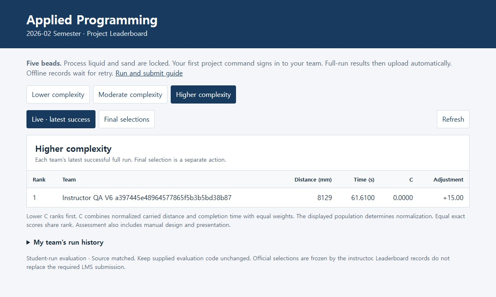

*Current five-bead Higher leaderboard captured on 15 November 2026 with a temporary instructor HTTPS verification entry. The entry was removed after verification. It is not a student result.*

**Live · latest success** and **Final selections** show those separate comparisons. **D** is carried cup-centre distance displayed in millimetres. **T** is simulated task time displayed in seconds, not computer runtime. **C** combines normalized D and T with equal weights within the displayed group. Smaller C ranks higher.

The public board shows result summaries only. Other teams cannot see your robot layouts, handoff coordinates, joint paths or source code. The `history` command uses your saved sign-in to show your team's attempts. Signed-in teammates share that private history.

### 7.2 Retry an upload without repeating physics

If the upload status is `pending`, keep your output and run this after reconnecting:

```bat
python -B project_run.py retry
python -B project_run.py history --rule-id ap2026-%LEVEL%-beads-term-v6
```

Inspect the retry response and updated history. Retry uploads queued results and diagnostics **without rerunning Genesis**. It also prompts for first-use sign-in if needed. Acknowledged duplicates do not create extra records.

The supplied runner reports failed check, test, plan and review commands privately to the instructor. No bug-report form is required. If a completed review has no local automatic competition record, recover it from the unchanged review:

```bat
python -B project_run.py record ^
  --rule leaderboard/rules/term_v6/ap2026-%LEVEL%-beads-term-v6.json ^
  --review-dir "%RUN%/full"
```

This uses existing results and does not run physics.

<a id="43-select-your-final-run-and-submit"></a>

### 7.3 Select your final run and submit

**Every team submits its work, even without a successful full mission.** Use the same private team repository, presentation and LMS procedure. Follow the result branch below.

Commit and push the student files you are submitting to your shared private team repository, then obtain the full commit ID:

```bat
git rev-parse HEAD
```

**If you have a successful full run:** choose an uploaded successful run matching that commit. Set `RUN` to its folder. Enter the exact 40-character commit ID printed above:

```bat
set /p "COMMIT_ID=Paste the full 40-character commit ID: "
python -B project_run.py select --review-dir "%RUN%/full" --commit "%COMMIT_ID%"
```

Confirm `status: selected`, the intended `run_id` and full `commit_id`. All Python and JSON files under `student/` must match the evaluated snapshot, including helpers and unused tier designs. An older result cannot represent changed student code. The instructor freezes official selections for assessment.

**If you have no successful full run:** do not run `select`. Submit your implemented planner and design from that commit. Retain the original available execution records supporting that work. The existing rubric assesses your implementation, design and independently verified completed carries. Failed runs receive no competition adjustment. Submit the same presentation and LMS items below. No extra report or form is required.

Prepare **one team PowerPoint with 2–3 common slides plus 3 slides per member**, excluding the title. Include your private repository URL, the full commit ID for the presented results, case/settings, reproduction instructions and relevant execution records. Each member explains their role, changed files/functions, key code and effects on results, with links to their own pushed commits and relevant pull requests. Section 8.3 gives the presentation criteria.

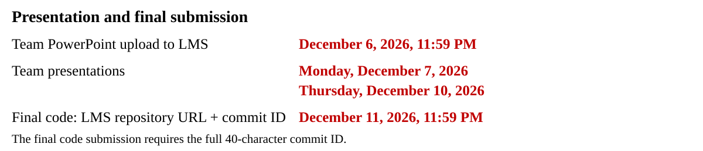

**Submit the team PPT file to LMS by December 6, 2026, 11:59 PM. Present on December 7 or December 10 as assigned. Submit the final private repository URL and full 40-character commit ID to LMS by December 11, 2026, 11:59 PM.**

Use the LMS submission field and file-upload area. Posting results only in Comments instead of submitting them in the required field will incur a deduction.

The presentation identifies the full commit ID used for its presented results. The final code submission identifies the final submitted revision. The leaderboard does not replace these deliverables. Section 8 states the assessment and competition rules.

## 8 Assessment

### 8.1 Base assessment

Let `M` be the base maximum in Section 2.1: 80, 90 or 100. The maximum is not an automatic award. Apply these criteria to the submitted student implementation and its matching records.

| Component | Maximum | Evidence and assessed work |
| --- | ---: | --- |
| Path implementation | 20% of M | Valid state/edge selection, route recovery and sensible search failure/query handling in `plan_path` |
| Layout, handoffs and geometric constraints | 20% of M | Permitted bases and relays, use of geometry/clearance, and how the choices affect reachability or interference |
| Speed design | 10% of M | Valid speed scale or edge times and their connection to the chosen motion |
| Valid transport completion | 50% of M | Verified complete carries divided by the required 1, 2 or 3 carries |

A valid carry includes its verified arrival, retained beads and supported release/rest. A partial path through a carry earns no fraction of that carry. Later failure does not erase earlier independently verified carries. Missing or unusable evidence is marked unknown for review, not invented as a measured zero. An incomplete run cannot enter the competition ranking.

For multi-person teams, the instructor adjusts each member's base by −5 to +5 for actual code contribution. A solo contribution adjustment is 0. Clamp the adjusted base to `[0, M]`. Then add the competition adjustment and presentation adjustment, with a final floor of 0.

For example, a Moderate team earning 30 of the 50 normalized design points and completing one of two valid carries has `90 × (30/100 + 0.5 × 1/2) = 49.5` base points before contribution adjustment.

### 8.2 Distance, time and competition

`D` is the actual cup-centre travel distance while a robot holds the cup, summed over physical outer steps. The board stores it in whole millimetres. It includes motion during held waits or handling. It excludes unheld approach, released cup rest and the supplied zero-time donor return. It is not joint-space distance in radians or the length of the planned tool path.

`T` is the verified completion clock in native `0.0025 s` ticks. It excludes the initial 200 preparation ticks and includes physical approach, carry, handling, waiting and required robot/cup rest. The fixed inclusive limits are 40 s, 85 s and 105 s for Lower, Moderate and Higher. Robot/cup dynamics and the existing fixed handling holds continue while supplied bead handling is idealized. Bead-state resets have zero simulation duration and do not move the cup, so they do not change D or T. Only extra material-settling waits and retries are removed. A spill detected during carrying remains failed after any reset.

For each complexity and active rule, compare one successful representative per team. A solo entry is one team. With that population's minima and maxima:

```text
Dn = (D - Dmin) / (Dmax - Dmin)
Tn = (T - Tmin) / (Tmax - Tmin)
C  = 0.5 * Dn + 0.5 * Tn
```

Lower `C` ranks higher. A metric with no variation contributes 0 for every team. The other weight remains 0.5. The server uses exact rational arithmetic for ties. Equal composites share rank, such as 1, 1, 3. Upload order and computer speed do not break ties.

The live board uses each team's latest successful run. New successful results can change the population's ranges and every displayed composite. Official assessment uses each team's explicitly selected successful run after the instructor freezes selection. A later failure remains in history and does not replace a success.

**Competition adjustment.**

Use the row for your complexity after ranking the successful representatives.

| Complexity | Rank 1 | Rank 2 | Rank 3 |
| --- | ---: | ---: | ---: |
| Lower | +5 | +3 | +1 |
| Moderate | +10 | +5 | +3 |
| Higher | +15 | +10 | +5 |

Let `N` be the number of successful representatives. Fourth place receives 0. If `N >= 5`, lower ranks receive:

```text
A(C) = -N * (C - C4) / (Cmax - C4)
```

`C4` is the composite of the fourth entry in sorted order, including ties. `Cmax` is the population's largest composite. If these are equal, every lower-rank adjustment is 0. With only four teams, fourth place also receives 0. For six teams with `C4 = 0.50` and `Cmax = 1.00`, composites 0.50, 0.75 and 1.00 give 0, −3 and −6 points. Failed runs receive no competition adjustment and are not part of `N`.

### 8.3 Presentation assessment

Use the team presentation specified in Section 7.3. Presentation contributes −10 to +10 after the base ceiling: shared team quality from −5 to +5, plus individual presentation from −5 to +5. Both apply to solo students too.

Each of the five team criteria and five individual criteria below receives **−1, 0 or +1**. Add the five team scores for the shared **−5 to +5** adjustment. Add each member's five individual scores for that member's **−5 to +5** adjustment. The two adjustments total **−10 to +10**. Both apply to solo students.

Use these anchors for each criterion:

- **−1:** The required explanation is absent, materially incorrect or unsupported by the available code and records.
- **0:** The explanation is accurate, clear and traceable to the relevant code, settings or records.
- **+1:** The explanation adds evidence-backed causal reasoning or a meaningful, justified tradeoff appropriate to that criterion.

Use the team table to organize the common part of the presentation. It identifies what the existing team-quality adjustment evaluates.

| Team criterion | What to explain |
| --- | --- |
| Mission and fixed constraints | The chosen task and the fixed conditions governing valid transport. |
| Layout and handoff reasoning | Placement and relay choices, reachability, clearance and interference. |
| Search and speed choices | The search method, connection checks, path recovery and chosen speed or edge times. |
| Traceable results and settings | The code revision, case/settings and supplied records supporting the shown outcomes. Make the conditions of any comparison identifiable. |
| Interpretation and limitations | What successes or failures show, the relevant tradeoffs and the limits of the conclusions. |

Use the individual table for each member's existing three-slide part. It evaluates technical explanation of that person's work, including clearly attributed joint work.

| Individual criterion | What to explain |
| --- | --- |
| Actual role and attribution | Own role, edited files/functions and relevant commit links. Identify each person's part in joint work. |
| Core code and search logic | How the relevant core code and search logic work. |
| Reasons for choices | Why the implementation or design choices were made. |
| Effects, debugging and results | How changes and debugging observations connect to the observed results. |
| Structured technical explanation | A coherent, precise account using correct terms and traceable code or result references. |

Use the code and records already produced for the project. No new experiment count, test authorship, report or form is required. Accurate analysis of failed runs can earn strong presentation marks. Commit counts, line counts, slide decoration and the presence of a video earn no points by themselves. The separate code-contribution adjustment evaluates actual work. Presentation evaluates the explanation and its supporting code and records.

## 9 Troubleshooting and updates

### 9.1 Read the first failure and revise the relevant input

Use the first reported failure to choose an action. The supplied runner automatically sends a bounded error summary, execution stage, command settings, environment versions and source hashes to the instructor's private issue view. It separates design failures from program or environment errors. It does not upload student source code, credentials or full logs. Reporting does not change the result or score.

`Diagnostic uploaded` confirms that the report reached the instructor. `Diagnostic pending` means it remains in `output/diagnostics_queue`. The instructor can see it after upload, not while the computer is offline. The next supplied-runner command retries pending reports. You can also use `python -B project_run.py retry` after reconnecting. Keep the original local records for detailed debugging. There is no separate bug-report form.

| Result | Next action |
| --- | --- |
| `NotImplementedError` or unset design | Complete the named student function or JSON choice |
| Fresh-directory error | Choose a new `RUN` or output subfolder |
| CPU search or endpoint failure | Open `CPU_PLANNING_RESULT.json` in the CPU output folder and read `failure`, then inspect the reported stage and your layout |
| Source mismatch | Restore supplied files and re-export your edited student design |
| `control:acceleration_limit` | Locate the failed phase and tick below. Increase relevant edge durations or revise the path, then create a fresh CPU export |
| Contact, loss or tracking failure | Revise the path, placement or speed and re-export |
| Pending upload | Retry the queued record without rerunning Genesis |
| Final selection mismatch | Select a run whose evaluated student files match the submitted commit |

<details>
<summary>Locate the failed speed-control edge in a full-run log</summary>

For a control rejection during an approach or carry, `%RUN%/full/REVIEW_SUPERVISOR.json` gives `worker_failure.message`. Open `%RUN%/full/device_tier_execution/TIER_DEVICE_RESULT.json` and read `failed_phase_prefix.purpose` for the stage. Inside that prefix, `checks.checks.control.flags` identifies the failed condition and `checks.checks.control.first_failed_step` gives its native tick. The stage elapsed time is `(first_failed_step - stage_start_tick) * 0.0025`. Use the prefix's `start_native_step` as `stage_start_tick`, unless earlier entries in `phases` have the same `purpose`. For a stage split into chunks, use the first such entry's `start_native_step`. Compare the elapsed time with the matching saved stage's `trajectory.waypoint_times_s` to locate the commanded edge. These JSON fields require no new analysis script.

Deceleration is already supplied. Changing the relevant duration in `choose_edge_durations_s`, reducing JSON speed scale, or revising the path changes the saved command. A longer duration is a design choice, not a guaranteed cure for physical contact or control failure. No prescribed multiplier or hidden replay retiming applies. Keep the fixed limits and re-export after each student-input edit.

</details>

Retain original records, including failed attempts. Supplied checks and source matching establish reproducibility boundaries, not remote attestation of a student-controlled computer.
### 9.2 Apply an instructor-announced update

Use these maintenance commands from your repository root in **Windows Anaconda Prompt**. Stop **all** project commands first, including direct CPU debugging, preview export and leaderboard commands. Use the existing `applied-programming-cuda` environment. The updater preserves `student/`, saved results, pending uploads, credentials, unknown files and Git history. It changes only verified supplied files. It does not install dependencies, commit changes, plan a path or launch Genesis.

**Existing design files:** an older `three-arm-design-v1` file remains supported. Complete only the carrying arms and actual handoffs in its existing `arms` and `relays` arrays, and keep its prefilled fixed finish unchanged. Unused fields may remain `null` in their supplied entries. The runner fills them internally without rewriting your file. An already completed older design is used unchanged. Use the `project_run.py plan` and `project_run.py review` commands in this guide. No manual conversion or replacement of your answers is required.

**Check and apply the exact announced release.**

Set `RELEASE` to the exact tag announced by the instructor. The current guidance release is shown below:

```bat
set "RELEASE=term-v6-readme-guide-20261115"
python -B project_run.py update check --release "%RELEASE%"
```

`UPDATE_CHECK_PASS` means the official release and your current supplied files passed the update checks. It does not apply files. Read its proposed changes, then apply that same tag:

```bat
python -B project_run.py update apply --release "%RELEASE%"
python -B project_run.py update status
```

`UPDATE_APPLIED` includes a `backup_id`. Keep the backup under `output/project_updates/`. `UPDATE_ALREADY_CURRENT` means no update was needed. `UPDATE_STATUS` reports local release and recovery information. Use `update check` to verify that state against the official release. Your own Python/JSON files and existing result records stay in place.

After an applied update, run the environment check and the supplied test for your chosen workflow. Review the supplied-file changes with your usual Git workflow and commit them to your team repository. The updater does not stage, commit or push for you. Create a **fresh CPU export** before the next physical replay. Do not edit or relabel older runs. A retry still uploads the original queued record under its original rule.

```bat
python -B project_run.py check --cuda --output output/update_environment.json
```

Choose one test command. For the shared `student/joint_strategy.py`:

```bat
python -B project_run.py test
```

For a separate arm module, set `ARM` to your assigned arm and check that module instead. This example uses `arm_0`. You do not need to run the shared-strategy test as well.

```bat
set "ARM=arm_0"
python -B project_run.py test-arm --strategy student.%ARM%_strategy --arm %ARM%
```

If the updater reports `UPDATE_REFUSED`, read its `code` and named paths. `LOCAL_SUPPLIED_FILE_CHANGED` means a supplied file differs from its released version. `UNMANAGED_FILE_COLLISION` means a new supplied file would overwrite another local file. Both stop before overwriting that work. Keep the files and ask the instructor to resolve the conflict. Do not reset your repository or copy a whole new package over it. `UPDATE_BUSY` means another project or maintenance command is running. Let it finish before retrying.

<details>
<summary>Rollback and interrupted-update recovery</summary>

If an applied update causes a problem, stop project commands and replace `BACKUP_ID` with the exact ID printed by `UPDATE_APPLIED` or listed by `update status`:

```bat
python -B project_run.py update rollback --backup BACKUP_ID
```

Continue after `UPDATE_ROLLED_BACK`. Rollback restores supplied files only. It preserves student edits made after the update, results and Git history. It refuses to overwrite supplied files that you changed after applying the update. If you had already committed the update, commit the rollback as a new change through your normal Git workflow. Retain the backup and existing run records.

If a maintenance command was interrupted, run `python -B project_run.py update status` before doing project work. The updater first recovers an unfinished file transaction. Ordinary runner commands refuse an unfinished update with `PROJECT_UPDATE_RECOVERY_REQUIRED`. If the main entry point is unavailable during the first migration, use the retained bootstrap file with `python -B "%BOOT%\update_project.py" status`. Recovery uses the local backup and does not need a network connection. Follow any reported recovery error instead of starting a new run.

</details>

<details>
<summary>Only for the original template without the update command</summary>

Use this block only if `project_run.py update` is unavailable in the original `term-v3-student-20261114` template. Keep your existing team repository. Choose a **fresh** `BOOT` folder name. These commands fetch the exact official tag and save the updater in ignored output storage without replacing your planner or the old runner:

```bat
set "RELEASE=term-v6-readme-guide-20261115"
set "BOOT=output\update_bootstrap_01"
mkdir "%BOOT%" && git fetch --no-tags https://github.com/SSUMechE/applied-programming-2026-term-project.git refs/tags/%RELEASE% && git show FETCH_HEAD:update_project.py > "%BOOT%\update_project.py"
python -B "%BOOT%\update_project.py" check --release "%RELEASE%"
```

Continue only after `UPDATE_CHECK_PASS`, then apply:

```bat
python -B "%BOOT%\update_project.py" apply --release "%RELEASE%"
python -B project_run.py update status
```

The one-time bootstrap fetch updates Git's `FETCH_HEAD`. It does not merge branches, alter your index, replace commits or change your remote URL. Normal updater fetches use their own isolated cache. Keep the bootstrap file. If rollback restores the old runner without an update command, invoke that saved file instead: `python -B "%BOOT%\update_project.py" rollback --backup BACKUP_ID`.

If creating the bootstrap folder or fetching the release failed, stop and preserve the error. Do not run a previously downloaded file by assuming the failed command succeeded. No package reinstall is part of an update.

</details>

### 9.3 Written examination and optional planning review


The written examination covers course content after the midterm and the project. December 11 or December 14, 2026 is tentative. One date will be confirmed.

For optional revision, MIT's [RRT exercise](https://manipulation.csail.mit.edu/Fall2020/pset5/rrt_planner.html) covers single-tree RRT, bidirectional RRT and shortcut smoothing. The [Motion Planning chapter](https://manipulation.csail.mit.edu/trajectories.html) explains configuration-space search. Apply the ideas through the supplied interfaces above. No MIT Docker/Drake installation or extra submission is required.
