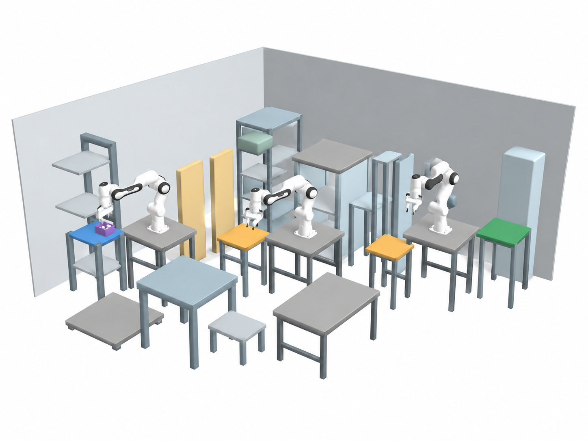
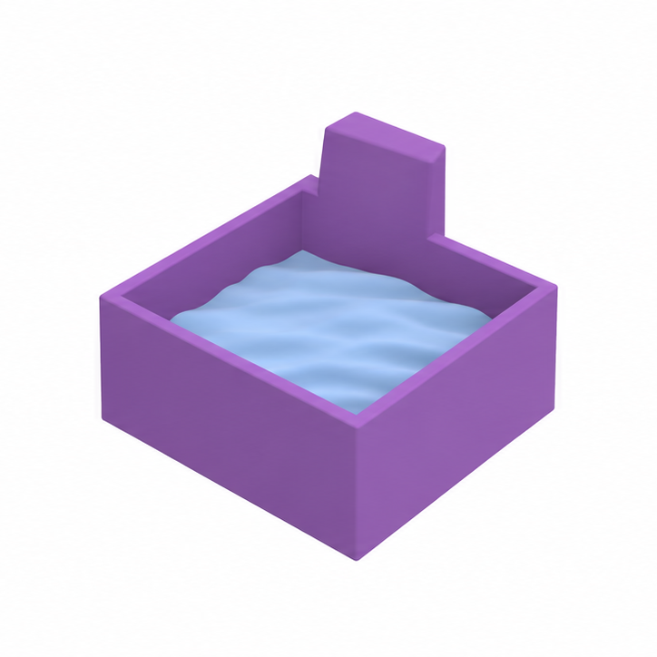
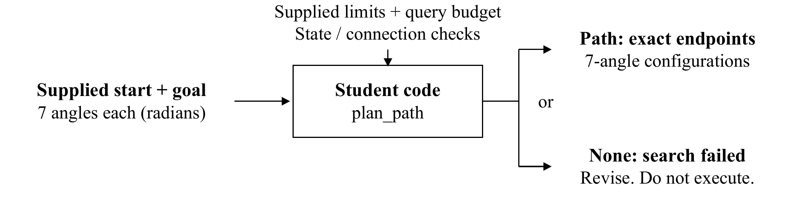
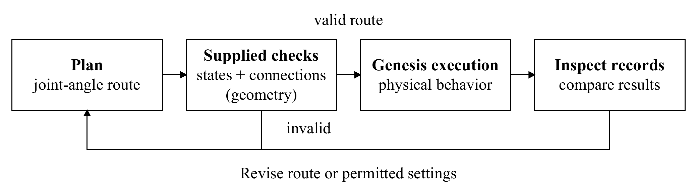
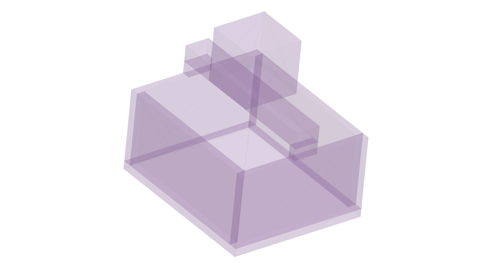

# Project Outline

*Applied Programming · 2026-02 semester*


*Figure 1. Franka Emika Panda sample transport concept, based on the Genesis robot and container. Concept illustration.*

[Project guide](docs/project_outline_with_appendix.pdf) · [Design API](docs/STUDENT_API.md) · [Run and submit](docs/EVALUATION_AND_SUBMISSION.md) · [Leaderboard](https://phoniness-reenact-veggie.ngrok-free.dev)

## 1 Project Background and Task

Physical AI connects computational decisions to physical action. In this project, a robot transports an open cup through a materials-processing cell while respecting equipment and sample constraints. Genesis evaluates how the planned motion affects the robot, container and contents.

Design robot placement, handoff locations, seven-joint paths and speed to reduce carrying distance and completion time. For the glass-bead stage, retain all **three original beads during every carry**. Supplied ideal handling resets them to prepared bead states between carries.

Complete the required transport tasks for the materials released for your selected complexity. **Glass beads are released first.** Additional materials will be released according to students’ progress. 

Verify your own layout, path and timing with the supplied checks. Official bead competition and final representative selection are active. GTX 1660 SUPER runtime and memory remain unmeasured.

## 2 Layout and Design Conditions

### 2.1 Layout Examples

Compare team size, required handoffs and the **simulated** deadline before choosing a task.

| Complexity | CLI name | Students | Base maximum | Carrying arms / handoffs | Deadline |
| --- | --- | ---: | ---: | ---: | ---: |
| Lower | `easy` | 1 | 80 | 1 / 0 | 40 s |
| Moderate | `medium` | 1–2 | 90 | 2 / 1 | 85 s |
| Higher | `hard` | 2–3 | 100 | 3 / 2 | 105 s |

Lower has wide passages and alternative routes. Moderate adds staggered barriers and a low roof. Higher adds separated mounting regions, overhead obstacles and two handoffs.

The supplied scene parks unused robot models automatically. You choose placements only for the arms that carry the cup.

| Lower complexity | Moderate complexity | Higher complexity |
| --- | --- | --- |
|  |  |  |

*Figure 2. Layout illustrations from the original Project Outline. See the [current map](docs/project-map-overview.png) and [3D viewer](docs/map_viewer.html) for exact geometry and permitted placements.*

Open `docs/map_viewer.html` from your cloned repository in Chrome or Edge. Keep its supplied JavaScript files beside it. Choose your complexity, then use **Preview your design JSON** to inspect selected bases and exact handoff points. Use **Preview your saved motion** to load your exported animation. **Stage**, **Frame** and **Play** show your motion. The **Planned cup path** or **Recorded cup path** checkbox shows the current stage's route. See [animation export](#38-inspect-or-save-your-animation-optional) for recorded bead motion and video output. Use the [map constraints](docs/MAPS_AND_DESIGN.md) when choosing placements.

Use the materials marked **Open** for your current work.

| **Open** | **Closed**<br>To be updated | **Closed**<br>To be updated |
| :---: | :---: | :---: |
| <br>**Glass beads** | <br>**Aqueous solution** | <br>**Silica sand** |

*Original Project Outline concept illustrations. The glass-bead task uses three original beads.*

### 2.2 Design Inputs

**Student-designed inputs:** choose the carrying robots' placements, intermediate handoff locations and seven-joint paths. Choose motion speed within the given limits. In filenames, `<tier>` means `easy`, `medium` or `hard`. Replace editable JSON `null` values with your choices. A **base** is a robot's mounting location. A **handoff** is where one arm places the cup for the next arm. Lower needs **1 base and no handoff**, Moderate **2 bases and 1 handoff**, and Higher **3 bases and 2 handoffs**. The supplied code fixes the source, finish and unused-arm parking. See [which entries to fill](docs/MAPS_AND_DESIGN.md#which-entries-do-i-fill).

| Decision | Input and units | Edit location |
| --- | --- | --- |
| Robot placement | Mounting surface, X/Y in m, yaw in rad. Surface choice fixes height. | `student/<tier>_design.json` → `arms` |
| Handoffs | Existing support ID and cup reference point's **world X/Y in m**. Height and orientation are supplied. | Same JSON → `handoffs` |
| Joint path | A sequence of seven-angle configurations in rad | `student/joint_strategy.py` → `plan_path` |
| Speed | `joint_speed_scale` in (0, 1], or one duration in seconds per path edge | Design JSON or `choose_edge_durations_s` |

In each `handoffs` entry, select an existing surface with `support_id`. Set the cup reference point with `x_m` and `y_m` in world metres, not offsets from the surface centre. The table stays fixed. Cup height and orientation are supplied.


*P is an illustrative cup reference point. The dashed region limits P. Obstacles are faded for visibility only. See the [JSON example and allowed regions](docs/MAPS_AND_DESIGN.md#choose-bases-and-handoffs).*

**Edit only these student targets:**

- `student/joint_strategy.py`: implement `plan_path`. Optionally implement `choose_edge_durations_s`. Put your own planner helper functions here or in helper modules under `student/`.
- Your selected `student/<tier>_design.json`: set `arms[].mount_region`, `arms[].base_placement.x_m`, `y_m`, `yaw_rad`, permitted `handoffs[].support_id`, `x_m`, `y_m`, and `joint_speed_scale`. Keep `schema_version`, `difficulty`, arm IDs and the supplied entry counts unchanged. Lower's `handoffs` stays `[]`. Do not add the fixed source, finish or unused-arm entries.

**Do not manually modify anything else supplied by the course. Unauthorized changes to supplied code or fixed data, or fabricated results, may receive ZERO for the project.** This includes planners outside `student/`, checkers, tests, physics, maps, limits, scoring rules and registration/recording code. Do not edit generated paths, logs or result receipts. Use the official updater for instructor-announced fixes. An authorized update is not a prohibited edit.

### 2.3 Your Implementation

Implement `plan_path` in `student/joint_strategy.py`. Each request gives one arm's exact start and goal configurations. Return at most **10,000 seven-angle configurations** in radians with those exact endpoints, or `None` when the search fails.

Only start and goal configurations are supplied. Generate intermediate configurations using RRT, bidirectional RRT, A*, or another suitable course method. Choose clearance constraints and connection sampling. Final validation resolution stays fixed.

**Share the work by arm.** In `plan_path`, use `context.active_arm_id` and `context.motion_kind` to select your team's arm-specific search or helper function. Merge everyone's work into one strategy and one selected design JSON. CPU planning exports the complete mission. Then [practice one selected arm](#36-start-physical-experiments-with-an-empty-cup), first with an empty cup and then with beads, before the full-scene review. See the [context contract](docs/STUDENT_API.md#implement-the-search).



*Figure 3. The student planner constructs the route. A failed search returns None for revision.*

### 2.4 Provided Support

FK, IK, geometry/surface queries, full-robot collision checks, automatic grasp/release and interpolation are provided. The [API guide](docs/STUDENT_API.md) defines exact calls and returns. FK and IK do not establish collision freedom.


*Figure 4. Inputs and outputs of the supplied kinematics helpers. State and connection checks remain separate.*

You do not implement kinematics, a gripping controller, a physics solver or a test harness. Keep the supplied code unchanged. Your work is the planner and permitted design inputs in Section 2.2.

### 2.5 Fixed Conditions

**Instructor-fixed constraints:** joint-angle bounds, maximum joint velocity and acceleration/deceleration, and tracking tolerance are supplied. Keep these limits unchanged. You may impose stricter constraints in your own planner.

Keep the map, source/finish, robot, cup, material properties and three original bead IDs unchanged. **Bead physics and contacts run only during carrying.** Preparation, approach, automatic pick/place and released or handoff waits use prepared bead states. The supplied routine instantly resets bead positions and velocities and timestamps those resets. Students do not implement or edit this handling routine. Angles must stay within `request.bounds`. Collision checks include the robot, cup, obstacles and other arms.

**Provided motion control:** the supplied interpolator **accelerates and decelerates to rest at every waypoint**. Your path and edge durations change the commanded motion. They do not change the permitted limits. You do not implement a braking controller.

| Joints | Maximum absolute velocity | Maximum absolute acceleration/deceleration |
| --- | ---: | ---: |
| 1–4 | 1.0 rad/s | 2.0 rad/s² |
| 5–7 | 1.4 rad/s | 2.8 rad/s² |

These instructor-fixed limits apply to commands and actual motion. Tracking error must stay within **0.03 rad**. Physics uses **0.0025 s** intervals and **16 internal substeps**. A legal command can still fail physical replay.

A spill during carrying immediately fails the run. All three original beads must pass the carry-end check before a place reset. A reset cannot replenish a missing bead or erase failure. Robot/cup physics, contact and support/rest checks continue throughout. Prohibited contact, control-limit violations or failed final support/rest also reject a run. There is no separate 8° spill gate or required slowdown multiplier.

After a handoff, the donor follows its reverse path kinematically with **zero physics time**. Only its final pose receives a contact check. This does not certify the return's swept collision freedom. The last carrier does not return.

### 2.6 Development Process

Treat a Genesis replay as a **virtual experiment**. Predict how a change in placement, path or timing will affect the motion, choose a suitable test, inspect its results, and revise your design. The [run guide](docs/EVALUATION_AND_SUBMISSION.md) gives the exact commands.



*Figure 5. Geometric checks establish route validity at the supplied resolution. Simulation reveals physical transport behavior.*

**Recommended first experiment: CPU geometry → empty cup → three glass beads.** First find a geometrically valid path on the CPU. Use an empty-cup Genesis experiment to check robot/cup motion, contact and automatic handling. Then replay the same saved path and timing with beads to test their motion and retention during carrying.

After the first comparison, target later experiments to the uncertainty you need to resolve. You do **not** need three full runs after every change. After editing the planner, layout, handoff or timing, export a fresh CPU plan before another physical experiment.

Team members can also [practice one arm in Genesis](docs/EVALUATION_AND_SUBMISSION.md#practice-one-arm-in-genesis-optional) using an empty cup or glass beads. These separate runs help diagnose each arm. Only the full bead mission can enter the leaderboard.

## 3 Start and Test Your Design

Use **Windows Anaconda Prompt**. Copy only the commands inside the code blocks, without terminal prompts or printed output. Run them from your team repository root, in the order below.

### 3.1 Create and clone your team's repository

On GitHub, choose **Use this template → Create a new repository**. Create **one private repository for your individual or team project**. Use the same name for this GitHub repository and your leaderboard account:

- **One student:** use your student ID only, such as `20260001`. This applies to a solo Lower or Moderate project.
- **Two or three students:** put all members' student IDs in ascending order, joined with `-`, such as `20260001-20260002`. Everyone uses this one shared repository and leaderboard name. Do not invent a separate nickname.

These are naming examples, not IDs to copy. Add **SSUMechE** and, for a group, every teammate as collaborators. Your usual weekly-assignment repository names do not change. Clone your private project repository, not the public course template:

```bat
cd /d "%USERPROFILE%"
set /p "TEAM_REPO_URL=Paste your private team repository URL: "
git -c core.longpaths=true clone "%TEAM_REPO_URL%" ap2026-team
cd ap2026-team
conda activate applied-programming-cuda
```

Continue only after cloning and environment activation succeed. `ap2026-team` is only the local folder name used by these commands. It is not your GitHub repository or leaderboard name. If you already have this project checkout, open its folder and activate the environment instead of cloning again. Use a different local folder for another project.

Each member must commit and push their own work using their own GitHub account. Keep design files, saved paths and motion previews in the private team workspace.

### 3.2 Register your team and check the environment

Use the student-ID name from [3.1](#31-create-and-clone-your-teams-repository) as your **Team name**, even when working alone. Choose a project password of at least **12 characters**. Group members share that password. Then run:

```bat
python -B project_run.py check --cuda --output output/environment.json
```

At first use, enter that student-ID name and password when prompted. Use a project-specific password, not your GitHub password. Type it only at the hidden password prompt. Each teammate uses the same pair once per checkout on each computer.

If this checkout already has a registered name, this instruction does not rename it. Keep its existing results and contact the instructor if the name is wrong. Do not create a second account or delete credentials to rename it.

On your first successful sign-in, confirm these results:

- `TEAM_CONNECTED: <your team name>`: this checkout is connected to your team.
- `ENVIRONMENT_CUDA_SMOKE_PASS`: the environment and short CUDA checks passed.

The client stores this computer's credential outside Git and reuses it automatically. Later checks do not repeat the sign-in prompt or TEAM_CONNECTED message. Each environment check must still report ENVIRONMENT_CUDA_SMOKE_PASS. No instructor-issued token, ngrok or VPN installation is required. If saved sign-in is refused, run `python -B project_run.py configure` and re-enter the same team password.

Keep **PyTorch 2.14.0+cu126** and **Genesis 1.3.2**. On an environment mismatch, preserve the output and wait for instructor guidance before changing packages. If sign-in is unavailable, local work can continue. Use [upload recovery](#42-retry-a-pending-upload) after reconnecting.

### 3.3 Choose your complexity and output folder

Copy **one** block. These variables last only in the current prompt window. The CLI names `easy`, `medium` and `hard` correspond to Lower, Moderate and Higher complexity.

**Lower complexity**

```bat
set "LEVEL=easy"
set "MAP=easy_open_v1"
set "RUN=output\lower_01"
```

**Moderate complexity**

```bat
set "LEVEL=medium"
set "MAP=medium_staggered_v1"
set "RUN=output\moderate_01"
```

**Higher complexity**

```bat
set "LEVEL=hard"
set "MAP=hard_industrial_v1"
set "RUN=output\higher_01"
```

For each revised attempt, choose a fresh `RUN`, such as `output\higher_02`. Keep earlier results. When reopening the prompt, return to your team repository folder, activate the environment and set these variables again.

### 3.4 Implement your planner and design

Before planning, complete these student files:

- `student/joint_strategy.py` → implement `plan_path` using the [provided API](docs/STUDENT_API.md).
- `student/%LEVEL%_design.json` → replace the editable `null` values for your carrying arms and handoffs. For example, `LEVEL=easy` selects `student/easy_design.json`, with one arm and `handoffs: []`. Follow the [per-tier entry table](docs/MAPS_AND_DESIGN.md#which-entries-do-i-fill). Keep the supplied entry counts unchanged.
- Choose `joint_speed_scale` in that JSON, or implement the optional `choose_edge_durations_s` function for individual edge times.

Follow the [edit boundary and zero-credit warning](#22-design-inputs). All other supplied code and fixed data must remain unchanged.

In `student/joint_strategy.py`, the comments **BEGIN REQUIRED STUDENT EDIT** and **BEGIN OPTIONAL STUDENT EDIT** mark the two function bodies. Keep their function signatures unchanged. The design JSON lists only your tier's required inputs. Edit its permitted values, not the schema or IDs.

The starter contains no completed path or reference layout. After implementation, run the supplied checks:

```bat
python -B project_run.py test
```

All **three** interface checks should pass. The unfinished starter intentionally fails two path checks. These checks test your function contracts, not map feasibility or physical transport. Keep the supplied code unchanged.

### 3.5 Export your CPU-checked path

```bat
python -B project_run.py plan --scope tier-mission --difficulty %LEVEL% --material beads --task cases/difficulty_20261106/%MAP% --design student/%LEVEL%_design.json --strategy student.joint_strategy --output "%RUN%/cpu"
```

Continue after `CPU_GEOMETRIC_TIER_MISSION_PLANNED`. The saved plan is `%RUN%/cpu/saved_tier_mission.json`. It contains your exact joint path, edge times, layout and source identities.

Keep `--material beads` in this planning command even when your next experiment uses an empty cup. The replay's `--contents` option selects whether samples are present.

If you implemented explicit edge times, set `joint_speed_scale` to `1.0` and append `--edge-timing-hook` to this command. Otherwise the JSON speed scale is used.

**Do not edit the planner, design or supplied files between export and replay.** After an edit, choose a fresh `RUN` and export again. CPU success does not prove bead retention or completion within the simulated deadline.

**Optional preview:** export your own motion for the provided 3D viewer:

```bat
python -B export_student_view.py --saved-tier "%RUN%/cpu/saved_tier_mission.json" --output "%RUN%/motion_preview.json"
```

Open `docs/map_viewer.html` locally in Chrome or Edge. Select your complexity, choose **Preview your saved motion**, and load the exported JSON. Use **Stage**, **Frame** and **Play** to see your planned path and handoff coordinates. This CPU preview has no simulated beads and does not run physics.

<a id="36-optionally-check-with-an-empty-cup"></a>

### 3.6 Start physical experiments with an empty cup

After CPU validation, **start your first physical experiment with an empty cup, then add beads**. These GPU runs are **virtual experiments in Genesis**: predict what your path and timing will do, test, observe and revise. The empty cup helps isolate robot/cup motion before adding payload behavior.

| 1. CPU: check geometry | 2. GPU: experiment with an empty cup | 3. GPU: experiment with three glass beads |
| :---: | :---: | :---: |
|  |  |  |
| Check configurations, connections and clearance. No physical integration. | Check tracking, contact, automatic pick/place and handoffs. No bead dynamics. | Add bead motion, contact, spill and retention checks during carrying. |

*Figure 6. Actual CPU geometry and recorded Genesis carrying views. Follow the columns from left to right for your first comparison. Both physical experiments use the same saved path and times.*

- [CPU planning and geometry checks](#35-export-your-cpu-checked-path): get low-cost geometric feedback on configurations, clearance and connections. Search time still depends on your planning strategy.
- **Empty-cup GPU experiment:** investigate robot/cup tracking, contact and automatic handling without bead physics. It cannot demonstrate bead retention.
- [Three-bead GPU experiment](#37-verify-the-full-glass-bead-mission): test bead motion, spill and retention during carrying alongside the robot/cup checks. Only a successful full bead mission can enter the ranking.

Empty-cup experiments omit bead dynamics and bead contacts, reducing the modeled work. **Total wall times can still be similar** because startup, cache state and the shared robot/cup checks also cost time. Use empty-cup results to diagnose motion and handling, then spend the bead experiment on payload behavior. An empty-cup pass does not prove bead retention.

The full-route empty-cup command is below. For a focused first experiment, use the per-arm commands instead. Keep the layout and saved motion unchanged for an empty/bead comparison. These are recommended development experiments, not additional required submissions or three compulsory full runs after every edit.

```bat
python -B project_run.py review --saved-tier "%RUN%/cpu/saved_tier_mission.json" --difficulty %LEVEL% --task cases/difficulty_20261106/%MAP% --design student/%LEVEL%_design.json --contents empty --output "%RUN%/empty"
```

This replays the saved motion in Genesis to check tracking, contact and automatic handling. In `%RUN%/empty/REVIEW_SUPERVISOR.json`, an empty-cup pass has `review_accepted` and `empty_mission_passed` both `true`. Its `full_mission_passed` remains `false`, as expected. It does not produce a competition record. After an empty-cup pass, continue to 3.7 with the unchanged saved plan. If you revise any input, return to CPU export with a fresh `RUN` before retesting.

**Optional: test one arm at a time.** After the complete CPU export in 3.5, select `arm_0` for Lower, `arm_0` or `arm_1` for Moderate, or any of `arm_0`, `arm_1`, `arm_2` for Higher. For example:

```bat
set "ARM=arm_0"
python -B project_run.py practice --saved-tier "%RUN%/cpu/saved_tier_mission.json" --difficulty %LEVEL% --task cases/difficulty_20261106/%MAP% --design student/%LEVEL%_design.json --arm %ARM% --contents empty --output "%RUN%/practice_%ARM%_empty"
python -B project_run.py practice --saved-tier "%RUN%/cpu/saved_tier_mission.json" --difficulty %LEVEL% --task cases/difficulty_20261106/%MAP% --design student/%LEVEL%_design.json --arm %ARM% --contents beads --output "%RUN%/practice_%ARM%_beads"
```

Each command runs that arm's saved approach, automatic pick, carry, automatic release and rest. The layout, handoff target, path and times stay unchanged. Other robots remain in the scene at the saved boundary commands and participate in collision checks. For a later arm, practice starts the cup on its saved source support and uses the same provided pick/place reset policy. It does not execute preceding arms or prove the complete handoff sequence. See the [practice scope and result fields](docs/EVALUATION_AND_SUBMISSION.md#practice-one-arm-in-genesis-optional).

Budget **computer wall time** separately from **simulation time**. A practice simulation includes initial preparation and the supplied handling/rest holds, as well as approach and carrying. These values are not the full-mission competition clock. See [time and cost](docs/EVALUATION_AND_SUBMISSION.md#interpret-time-and-cost) when comparing runs.

Read `PRACTICE_RESULT.json` in each output folder. `ARM_PRACTICE_PASS` means that isolated practice passed. Results remain local and **never count as a full mission or leaderboard entry**, even if every arm passes separately. Use a fresh output folder when repeating a command. Continue with 3.7 for the scored full run.

### 3.7 Verify the full glass-bead mission

```bat
python -B project_run.py review --saved-tier "%RUN%/cpu/saved_tier_mission.json" --difficulty %LEVEL% --task cases/difficulty_20261106/%MAP% --design student/%LEVEL%_design.json --contents beads --rule leaderboard/rules/term_v4/ap2026-%LEVEL%-beads-term-v4.json --output "%RUN%/full"
```

Genesis uses the same saved path and times with all **three original bead IDs**. Bead dynamics run during each carry. Supplied ideal handling performs pick/place and timestamped resets to prepared bead states outside carries. Carry failure remains failed after any reset. Every completed full bead review automatically records success or failure. No separate result packaging or manual upload is needed.

Wait for the review to finish, then inspect the results below. For expected computational cost and detailed failure recovery, see the [run guide](docs/EVALUATION_AND_SUBMISSION.md#interpret-time-and-cost).

**Measured cost of one-arm practice**

Use this instructor-PC example to budget the optional one-arm tests in 3.6. Higher isolated arm practice on NVIDIA GeForce RTX 4090. One run per arm and contents. Paired empty and bead runs reuse each arm's saved path and timing. Existing shared caches were reused. The cold/warm cache state was not measured.

| Arm | Empty wall (mm:ss) | Three-bead wall (mm:ss) | Total simulation (s) | Motion only (s) |
| --- | --- | --- | --- | --- |
| arm_0 | 14:54 | 14:45 | 25.37 | 21.87 |
| arm_1 | 12:31 | 13:02 | 22.46 | 18.96 |
| arm_2 | 8:40 | 9:39 | 15.29 | 11.79 |

**Wall** covers the complete command: startup, scene preparation, physics, checks and logging. It excludes previous CPU planning and queue waiting. **Total simulation** includes initial preparation and supplied handling/rest holds. **Motion only** is approach plus carry. A single simulation value applies to both modes. A pair means empty / beads.

These are isolated practice measurements, not full-mission scores or runtime guarantees. Choose the test by the physical question. Empty and bead total wall times can be close.

### 3.8 Inspect or save your animation (optional)

After the bead review, export its recorded motion without running Genesis again:

```bat
python -B export_physics_view.py --saved-tier "%RUN%/cpu/saved_tier_mission.json" --review-dir "%RUN%/full" --fps 30 --output "%RUN%/physics_preview.json"
```

Load `physics_preview.json` using **Preview your saved motion** in the same local viewer. **Follow cup** keeps the moving container in view. **Cup interior only** hides surrounding equipment, and **Transparent cup** reveals the recorded beads. **Recorded cup path (current stage)** displays that phase's route. CPU previews label this **Planned cup path (current stage)**. Instant bead changes at logged handling resets are supplied idealization, not continuous bead dynamics.

Choose **Visual quality**, then **Save PNG** or **Save WebM**. Video can include the selected stage or all stages. Higher quality changes image resolution and video frame rate, not physics or grading. Keep the browser tab visible during recording. See the [animation controls and limits](docs/EVALUATION_AND_SUBMISSION.md#inspect-and-save-animations-optional). Animations stay local and are not uploaded to the public leaderboard. No animation submission is required.

## 4 Results, Leaderboard and Submission

### 4.1 Check physical success and registration

```bat
type "%RUN%\full\REVIEW_SUPERVISOR.json"
type "%RUN%\full\LEADERBOARD_STATUS.json"
python -B project_run.py history --rule-id ap2026-%LEVEL%-beads-term-v4
```

Check the two results separately:

- **Physical pass:** `review_accepted`, `physical_transport_accepted` and `full_mission_passed` must all be `true` in `REVIEW_SUPERVISOR.json`.
- **Upload acknowledged:** `LEADERBOARD_STATUS.json` reports `"status": "uploaded"`. This alone is not a physics pass. A failed full attempt can also upload successfully.

[Open the leaderboard](https://phoniness-reenact-veggie.ngrok-free.dev), select your complexity, then refresh. A successful acknowledged full run appears in the live comparison. Team registration, CPU planning and empty-cup checks do not create a ranked result.

The live comparison uses each team's **latest successful run**. A later failure stays in team history without replacing that success. The official comparison uses the successful representative each team explicitly selects.


*Public leaderboard captured on 15 November 2026 with a temporary instructor HTTPS verification entry. The entry was removed after verification. It is not a student result.*

**Live · latest success** and **Final selections** show those separate comparisons. **D** is carried cup-centre distance displayed in millimetres. **T** is simulated task time displayed in seconds, not computer runtime. **C** combines normalized D and T with equal weights within the displayed group. Smaller C ranks higher.

The public board shows result summaries only. Other teams cannot see your robot layouts, handoff coordinates, joint paths or source code. The `history` command uses your saved sign-in to show your team's attempts. Signed-in teammates share that private history.

### 4.2 Retry a pending upload

If the upload status is `pending`, keep your output and run this after reconnecting:

```bat
python -B project_run.py retry
python -B project_run.py history --rule-id ap2026-%LEVEL%-beads-term-v4
```

Inspect the retry response and updated history. Retry uploads queued results and diagnostics **without rerunning Genesis**. It also prompts for first-use sign-in if needed. Acknowledged duplicates do not create extra records.

The supplied runner reports failed check, test, plan and review commands privately to the instructor. No bug-report form is required. If the automatic local result file was not created, use the [record-recovery command](docs/EVALUATION_AND_SUBMISSION.md#6-retry-an-upload-without-repeating-genesis).

### 4.3 Select your final run and submit

**Every team submits its work, even without a successful full mission.** Use the same private team repository, presentation and LMS procedure. Follow the result branch below.

Commit and push the student files you are submitting to your shared private team repository, then obtain the full commit ID:

```bat
git rev-parse HEAD
```

**If you have a successful full run:** choose an uploaded successful run matching that commit. Set `RUN` to its folder. Enter the exact 40-character commit ID printed above:

```bat
set /p "COMMIT_ID=Paste the full 40-character commit ID: "
python -B project_run.py select --review-dir "%RUN%/full" --commit "%COMMIT_ID%"
```

Confirm `status: selected`, the intended `run_id` and full `commit_id`. All Python and JSON files under `student/` must match the evaluated snapshot, including helpers and unused tier designs. An older result cannot represent changed student code. See [final-selection details](docs/EVALUATION_AND_SUBMISSION.md#7-select-the-final-representative-and-submit).

**If you have no successful full run:** do not run `select`. Submit your implemented planner and design from that commit. Retain the original available execution records supporting that work. The existing rubric assesses your implementation, design and independently verified completed carries. Failed runs receive no competition adjustment. Submit the same presentation and LMS items below. No extra report or form is required.

Prepare **one team PowerPoint with 2–3 common slides plus 3 slides per member**, excluding the title. Explain design choices, results and each member's contribution using the actual commit and push history of the shared repository.


Use the LMS submission field and file-upload area. Posting results only in Comments instead of submitting them in the required field will incur a deduction.

The presentation identifies the full commit ID used for its presented results. The final code submission identifies the final submitted revision. The leaderboard does not replace these deliverables. See [assessment and competition](docs/SCORING.md) for the complete scoring rules.

## 5 Updates and Recovery

Use the supplied updater when the instructor announces a fix. It preserves your `student/` work, `output/` records and upload queues, credentials and Git history. It applies verified supplied files from an exact official release and keeps a rollback backup. It does not install packages or run Genesis.

Run `python -B project_run.py update status` to see the installed release. Follow [the update and rollback commands](docs/EVALUATION_AND_SUBMISSION.md#keep-supplied-code-current). That guide also covers the first update from the earlier template. Stop running project commands before applying an update. Local changes to supplied files cause a refusal rather than being overwritten.


