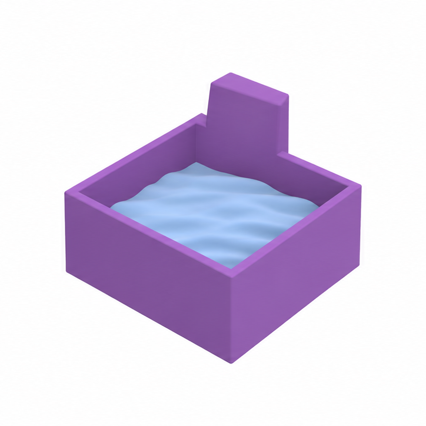
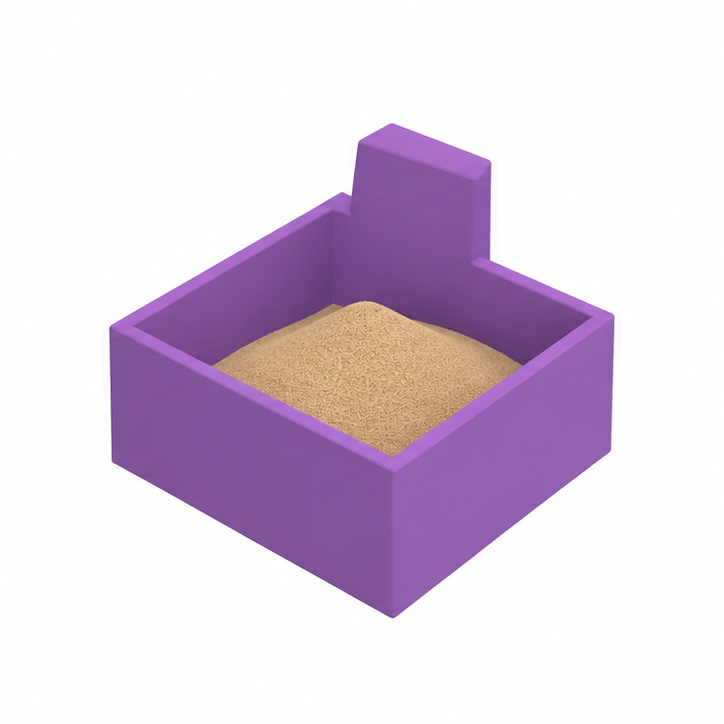
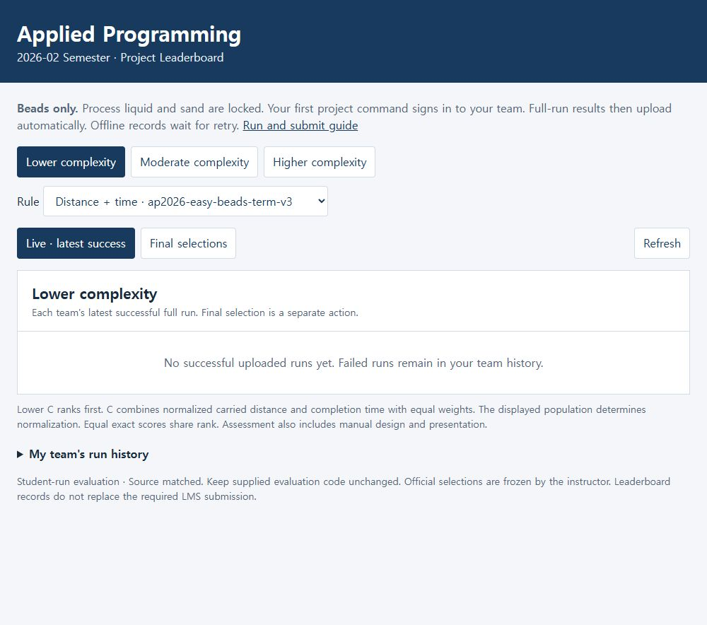
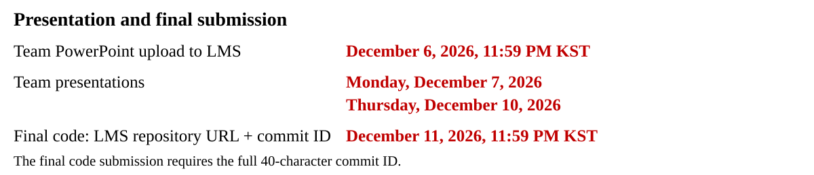

# Project Outline

*Applied Programming · 2026-02 semester*


*Figure 1. Franka Emika Panda sample transport concept, based on the Genesis robot and container. Concept illustration.*

[Project guide](docs/project_outline_with_appendix.pdf) · [Design API](docs/STUDENT_API.md) · [Run and submit](docs/EVALUATION_AND_SUBMISSION.md) · [Leaderboard](https://phoniness-reenact-veggie.ngrok-free.dev)

## 1 Project Background and Task

Physical AI connects computational decisions to physical action. In this project, a robot transports an open cup through a materials-processing cell while respecting equipment and sample constraints. Genesis evaluates how the planned motion affects the robot, container and contents.

Design robot placement, handoff locations, seven-joint paths and speed to reduce carrying distance and completion time. For the glass-bead stage, preserve all **four original beads**.

Complete the required transport tasks for the materials released for your selected complexity. **Glass beads are released first.** Additional materials will be released according to students’ progress. 

The supplied bead workflows have been tested on an RTX 4090. Your own design still needs verification. Official bead competition and final representative selection are active. GTX 1660 SUPER runtime and memory remain unmeasured.

## 2 Layout and Design Conditions

### 2.1 Layout Examples

Compare team size, required handoffs and the **simulated** deadline before choosing a task.

| Complexity | CLI name | Students | Base maximum | Carrying arms / handoffs | Deadline |
| --- | --- | ---: | ---: | ---: | ---: |
| Lower | `easy` | 1 | 80 | 1 / 0 | 40 s |
| Moderate | `medium` | 1–2 | 90 | 2 / 1 | 85 s |
| Higher | `hard` | 2–3 | 100 | 3 / 2 | 105 s |

Lower has wide passages and alternative routes. Moderate adds staggered barriers and a low roof. Higher adds separated mounting regions, overhead obstacles and two handoffs.

All scenes contain three robot models. Unused arms remain parked collision geometry, so every base needs a valid placement.

| Lower complexity | Moderate complexity | Higher complexity |
| --- | --- | --- |
|  |  |  |

*Figure 2. Layout illustrations from the original Project Outline. See the [current map](docs/project-map-overview.png) and [3D viewer](docs/map_viewer.html) for exact geometry and permitted placements.*

Open `docs/map_viewer.html` from your cloned repository in a browser. Keep `motion_preview.js` beside it. Choose your complexity, then use **Preview your design JSON** to inspect selected bases and exact handoff points. Use **Preview your saved motion** to load an exported motion preview, then choose **Stage** and **Frame** to inspect planned joint motion. Use the [map constraints](docs/MAPS_AND_DESIGN.md) when choosing placements.

Use the materials marked **Open** for your current work.

| **Open** | **Closed**<br>To be updated | **Closed**<br>To be updated |
| :---: | :---: | :---: |
| <br>**Glass beads** | <br>**Aqueous solution** | <br>**Silica sand** |

*Original Project Outline concept illustrations. The glass-bead task uses four original beads.*

### 2.2 Design Inputs

**Student-designed inputs:** choose robot placement, handoff locations and the seven-joint path. Choose motion speed within the given limits. In filenames, `<tier>` means `easy`, `medium` or `hard`. Replace editable JSON `null` values with your choices. Complete all three base entries and both relay entries, including unused scene entries, while preserving the fixed source and finish.

| Decision | Input and units | Edit location |
| --- | --- | --- |
| Robot placement | Mounting surface, X/Y in m, yaw in rad. Surface choice fixes height. | `student/<tier>_design.json` → `arms` |
| Handoffs | Allowed support ID and landing X/Y in m | Same JSON → `relays` |
| Joint path | A sequence of seven-angle configurations in rad | `student/joint_strategy.py` → `plan_path` |
| Speed | `joint_speed_scale` in (0, 1], or one duration in seconds per path edge | Design JSON or `choose_edge_durations_s` |

### 2.3 Your Implementation

Implement `plan_path` in `student/joint_strategy.py`. Each request gives one arm's exact start and goal configurations. Return at most **10,000 seven-angle configurations** in radians with those exact endpoints, or `None` when the search fails.

Only start and goal configurations are supplied. Generate intermediate configurations using RRT, bidirectional RRT, A*, or another suitable course method. Choose clearance constraints and connection sampling. Final validation resolution stays fixed.


*Figure 3. The student planner constructs the route. A failed search returns None for revision.*

### 2.4 Provided Support

FK, IK, geometry/surface queries, full-robot collision checks, automatic grasp/release and interpolation are provided. The [API guide](docs/STUDENT_API.md) defines exact calls and returns. FK and IK do not establish collision freedom.


*Figure 4. Inputs and outputs of the supplied kinematics helpers. State and connection checks remain separate.*

You do not implement kinematics, a gripping controller, a physics solver or a test harness. Keep the supplied code unchanged. Your work is the planner and permitted design inputs in Section 2.2.

### 2.5 Fixed Conditions

**Instructor-fixed constraints:** joint-angle bounds, maximum joint velocity and acceleration/deceleration, and tracking tolerance are supplied. Keep these limits unchanged. You may impose stricter constraints in your own planner.

Keep the map, source/finish, robot, cup, material and original four beads unchanged. Handoffs never reset or replace beads. Angles must stay within `request.bounds`. Collision checks include the robot, cup, obstacles and other arms.

**Provided motion control:** the supplied interpolator **accelerates and decelerates to rest at every waypoint**. Your path and edge durations change the commanded motion. They do not change the permitted limits. You do not implement a braking controller.

| Joints | Maximum absolute velocity | Maximum absolute acceleration/deceleration |
| --- | ---: | ---: |
| 1–4 | 1.0 rad/s | 2.0 rad/s² |
| 5–7 | 1.4 rad/s | 2.8 rad/s² |

These instructor-fixed limits apply to commands and actual motion. Tracking error must stay within **0.03 rad**. Physics uses **0.0025 s** intervals and **16 internal substeps**. A legal command can still fail physical replay.

Actual bead loss, prohibited contact, control-limit violations, or failed final support/rest reject a run. There is no separate 8° spill gate or required slowdown multiplier.

After a handoff, the donor follows its reverse path kinematically with **zero physics time**. Only its final pose receives a contact check. This does not certify the return's swept collision freedom. The last carrier does not return.

### 2.6 Development Process

Follow the [CPU → optional empty cup → beads workflow](docs/EVALUATION_AND_SUBMISSION.md). Inspect contact, tracking, bead retention and arrival records, then revise the path or permitted settings and export a fresh plan.


*Figure 5. Geometric checks establish route validity at the supplied resolution. Simulation reveals physical transport behavior.*

The same saved CPU path and timing are reused for both physical checks. After editing your planner or design, export a fresh plan. The optional 3D preview shows your own saved motion before physics.

## 3 Start and Test Your Design

Use **Windows Anaconda Prompt**. Copy only the commands inside the code blocks, without terminal prompts or printed output. Run them from your team repository root, in the order below.

### 3.1 Create and clone your team's repository

On GitHub, choose **Use this template → Create a new repository**. Create **one private repository per team**, then add every teammate and **SSUMechE** as collaborators. Clone that private repository, not the public course template:

```bat
cd /d "%USERPROFILE%"
set /p "TEAM_REPO_URL=Paste your private team repository URL: "
git -c core.longpaths=true clone "%TEAM_REPO_URL%" ap2026-team
cd ap2026-team
conda activate applied-programming-cuda
```

Continue only after cloning and environment activation succeed. If you already have this team checkout, open its folder and activate the environment instead of cloning again. Use a different folder for another team.

Each member must commit and push their own work using their own GitHub account. Keep design files, saved paths and motion previews in the private team workspace.

### 3.2 Register your team and check the environment

Agree on one unique team name and a shared project password of at least **12 characters**. Then run:

```bat
python -B project_run.py check --cuda --output output/environment.json
```

At first use, enter the agreed team name and password when prompted. Use a project-specific password, not your GitHub password. Type it only at the hidden password prompt. Each teammate uses the same pair once per checkout on each computer.

On your first successful sign-in, confirm these results:

- `TEAM_CONNECTED: <your team name>`: this checkout is connected to your team.
- `ENVIRONMENT_CUDA_SMOKE_PASS`: the environment and short CUDA checks passed.

The client stores this computer's credential outside Git and reuses it automatically. Later checks do not repeat the sign-in prompt or TEAM_CONNECTED message. Each environment check must still report ENVIRONMENT_CUDA_SMOKE_PASS. No instructor-issued token, ngrok or VPN installation is required. If saved sign-in is refused, run `python -B project_run.py configure` and re-enter the same team password.

Keep **PyTorch 2.14.0+cu126** and **Genesis 1.3.2**. On an environment mismatch, preserve the output and wait for instructor guidance before changing packages. If sign-in is unavailable, local work can continue. Use [upload recovery](#42-retry-a-pending-upload) after reconnecting.

### 3.3 Choose your complexity and output folder

Copy **one** block. These variables last only in the current prompt window. The CLI names `easy`, `medium` and `hard` correspond to Lower, Moderate and Higher complexity.

**Lower complexity**

```bat
set "LEVEL=easy"
set "MAP=easy_open_v1"
set "RUN=output\lower_01"
```

**Moderate complexity**

```bat
set "LEVEL=medium"
set "MAP=medium_staggered_v1"
set "RUN=output\moderate_01"
```

**Higher complexity**

```bat
set "LEVEL=hard"
set "MAP=hard_industrial_v1"
set "RUN=output\higher_01"
```

For each revised attempt, choose a fresh `RUN`, such as `output\higher_02`. Keep earlier results. When reopening the prompt, return to your team repository folder, activate the environment and set these variables again.

### 3.4 Implement your planner and design

Before planning, complete these student files:

- `student/joint_strategy.py` → implement `plan_path` using the [provided API](docs/STUDENT_API.md).
- `student/%LEVEL%_design.json` → replace the editable `null` values with your placement and handoff choices. For example, `LEVEL=easy` selects `student/easy_design.json`. Complete all three base entries and both relay entries, including unused scene entries. Preserve the fixed source and finish.
- Choose `joint_speed_scale` in that JSON, or implement the optional `choose_edge_durations_s` function for individual edge times.

The starter contains no completed path or reference layout. After implementation, run the supplied checks:

```bat
python -B project_run.py test
```

All **three** interface checks should pass. The unfinished starter intentionally fails two path checks. These checks test your function contracts, not map feasibility or physical transport. Keep the supplied code unchanged.

### 3.5 Export your CPU-checked path

```bat
python -B project_run.py plan --scope tier-mission --difficulty %LEVEL% --material beads --task cases/difficulty_20261106/%MAP% --design student/%LEVEL%_design.json --strategy student.joint_strategy --output "%RUN%/cpu"
```

Continue after `CPU_GEOMETRIC_TIER_MISSION_PLANNED`. The saved plan is `%RUN%/cpu/saved_tier_mission.json`. It contains your exact joint path, edge times, layout and source identities.

If you implemented explicit edge times, set `joint_speed_scale` to `1.0` and append `--edge-timing-hook` to this command. Otherwise the JSON speed scale is used.

**Do not edit the planner, design or supplied files between export and replay.** After an edit, choose a fresh `RUN` and export again. CPU success does not prove bead retention or completion within the simulated deadline.

**Optional preview:** export your own motion for the provided 3D viewer:

```bat
python -B export_student_view.py --saved-tier "%RUN%/cpu/saved_tier_mission.json" --output "%RUN%/motion_preview.json"
```

Open `docs/map_viewer.html` locally in a browser. Select your complexity, choose **Preview your saved motion**, and load the exported JSON. Inspect **Stage** and **Frame** to see your path and handoff coordinates. This preview does not run physics.

### 3.6 Optionally check with an empty cup

```bat
python -B project_run.py review --saved-tier "%RUN%/cpu/saved_tier_mission.json" --difficulty %LEVEL% --task cases/difficulty_20261106/%MAP% --design student/%LEVEL%_design.json --contents empty --output "%RUN%/empty"
```

This replays the saved motion in Genesis to check tracking, contact and automatic handling. In `%RUN%/empty/REVIEW_SUPERVISOR.json`, an empty-cup pass has `review_accepted` and `empty_mission_passed` both `true`. Its `full_mission_passed` remains `false`, as expected. It does not test bead retention or produce a competition record. If you revise your inputs after a failure, return to CPU export with a fresh `RUN`.

### 3.7 Verify the full glass-bead mission

```bat
python -B project_run.py review --saved-tier "%RUN%/cpu/saved_tier_mission.json" --difficulty %LEVEL% --task cases/difficulty_20261106/%MAP% --design student/%LEVEL%_design.json --rule leaderboard/rules/term_v3/ap2026-%LEVEL%-beads-term-v3.json --output "%RUN%/full"
```

Genesis uses the same saved path and times with all **four original beads**. Grasping, placement and required handoffs are automatic. Every completed full bead review automatically records success or failure. No separate result packaging or manual upload is needed.

Wait for the review to finish, then inspect the results below. For expected computational cost and detailed failure recovery, see the [run guide](docs/EVALUATION_AND_SUBMISSION.md#interpret-time-and-cost).

## 4 Results, Leaderboard and Submission

### 4.1 Check physical success and registration

```bat
type "%RUN%\full\REVIEW_SUPERVISOR.json"
type "%RUN%\full\LEADERBOARD_STATUS.json"
python -B project_run.py history --rule-id ap2026-%LEVEL%-beads-term-v3
```

Check the two results separately:

- **Physical pass:** `review_accepted`, `physical_transport_accepted` and `full_mission_passed` must all be `true` in `REVIEW_SUPERVISOR.json`.
- **Upload acknowledged:** `LEADERBOARD_STATUS.json` reports `"status": "uploaded"`. This alone is not a physics pass. A failed full attempt can also upload successfully.

[Open the leaderboard](https://phoniness-reenact-veggie.ngrok-free.dev), select your complexity and its `term_v3` rule, then refresh. A successful acknowledged full run appears in the live comparison. Team registration, CPU planning and empty-cup checks do not create a ranked result.

The live comparison uses each team's **latest successful run**. A later failure stays in team history without replacing that success. The official comparison uses the successful representative each team explicitly selects.



*Live leaderboard captured on 14 November 2026, before successful student uploads.*

**Live · latest success** and **Final selections** show those separate comparisons. **D** is carried cup-centre distance displayed in millimetres. **T** is simulated task time displayed in seconds, not computer runtime. **C** combines normalized D and T with equal weights within the displayed group. Smaller C ranks higher.

The public board shows result summaries only. Other teams cannot see your robot layouts, handoff coordinates, joint paths or source code. The `history` command uses your saved sign-in to show your team's attempts. Signed-in teammates share that private history.

### 4.2 Retry a pending upload

If the upload status is `pending`, keep your output and run this after reconnecting:

```bat
python -B project_run.py retry
python -B project_run.py history --rule-id ap2026-%LEVEL%-beads-term-v3
```

Inspect the retry response and updated history. Retry uploads queued results and diagnostics **without rerunning Genesis**. It also prompts for first-use sign-in if needed. Acknowledged duplicates do not create extra records.

The supplied runner reports failed check, test, plan and review commands privately to the instructor. No bug-report form is required. If the automatic local result file was not created, use the [record-recovery command](docs/EVALUATION_AND_SUBMISSION.md#6-retry-an-upload-without-repeating-genesis).

### 4.3 Select your final run and submit

**Every team submits its work, even without a successful full mission.** Use the same private team repository, presentation and LMS procedure. Follow the result branch below.

Commit and push the student files you are submitting to your shared private team repository, then obtain the full commit ID:

```bat
git rev-parse HEAD
```

**If you have a successful full run:** choose an uploaded successful run matching that commit. Set `RUN` to its folder. Enter the exact 40-character commit ID printed above:

```bat
set /p "COMMIT_ID=Paste the full 40-character commit ID: "
python -B project_run.py select --review-dir "%RUN%/full" --commit "%COMMIT_ID%"
```

Confirm `status: selected`, the intended `run_id` and full `commit_id`. All Python and JSON files under `student/` must match the evaluated snapshot, including helpers and unused tier designs. An older result cannot represent changed student code. See [final-selection details](docs/EVALUATION_AND_SUBMISSION.md#7-select-the-final-representative-and-submit).

**If you have no successful full run:** do not run `select`. Submit your implemented planner and design from that commit. Retain the original available execution records supporting that work. The existing rubric assesses your implementation, design and independently verified completed carries. Failed runs receive no competition adjustment. Submit the same presentation and LMS items below. No extra report or form is required.

Prepare **one team PowerPoint with 2–3 common slides plus 3 slides per member**, excluding the title. Explain design choices, results and each member's contribution using the actual commit and push history of the shared repository.



Use the LMS submission field and file-upload area. Posting results only in Comments instead of submitting them in the required field will incur a deduction.

The presentation identifies the full commit ID used for its presented results. The final code submission identifies the final submitted revision. The leaderboard does not replace these deliverables. See [assessment and competition](docs/SCORING.md) for the complete scoring rules.

## 5 Updates and Recovery

Use the supplied updater when the instructor announces a fix. It preserves your `student/` work, `output/` records and upload queues, credentials and Git history. It applies verified supplied files from an exact official release and keeps a rollback backup. It does not install packages or run Genesis.

Run `python -B project_run.py update status` to see the installed release. Follow [the update and rollback commands](docs/EVALUATION_AND_SUBMISSION.md#keep-supplied-code-current). That guide also covers the first update from the earlier template. Stop running project commands before applying an update. Local changes to supplied files cause a refusal rather than being overwritten.


