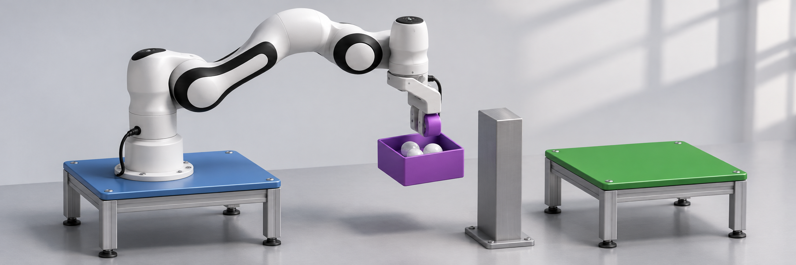
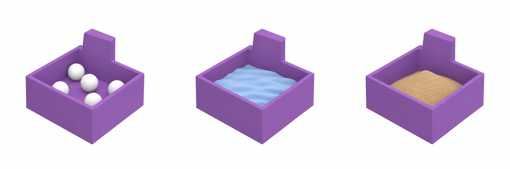
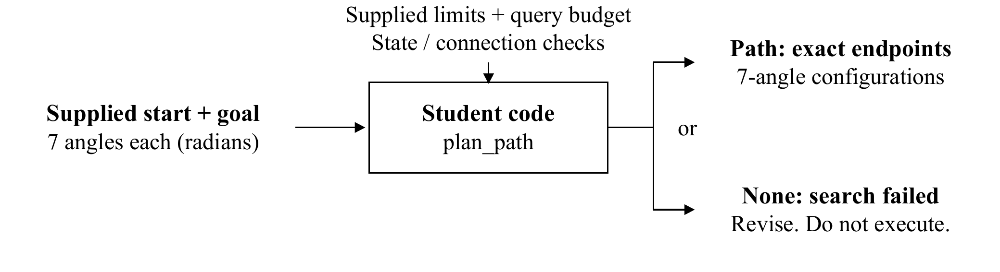
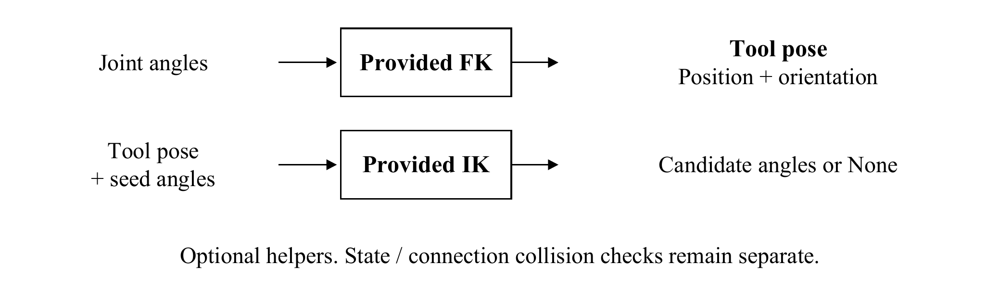
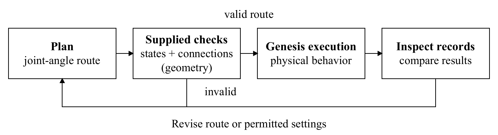
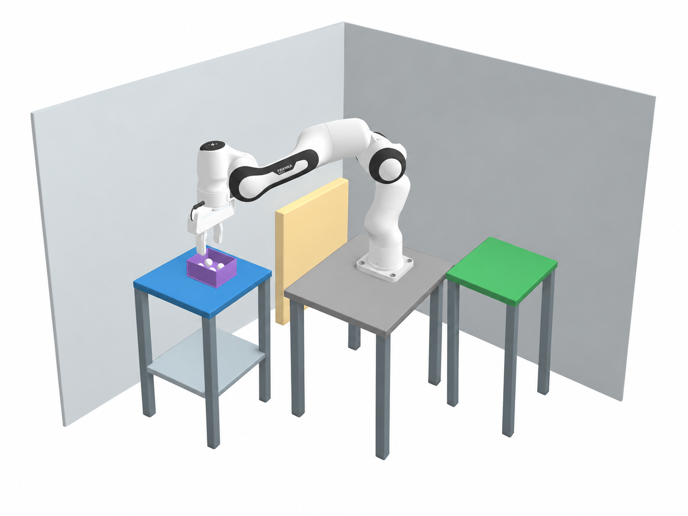
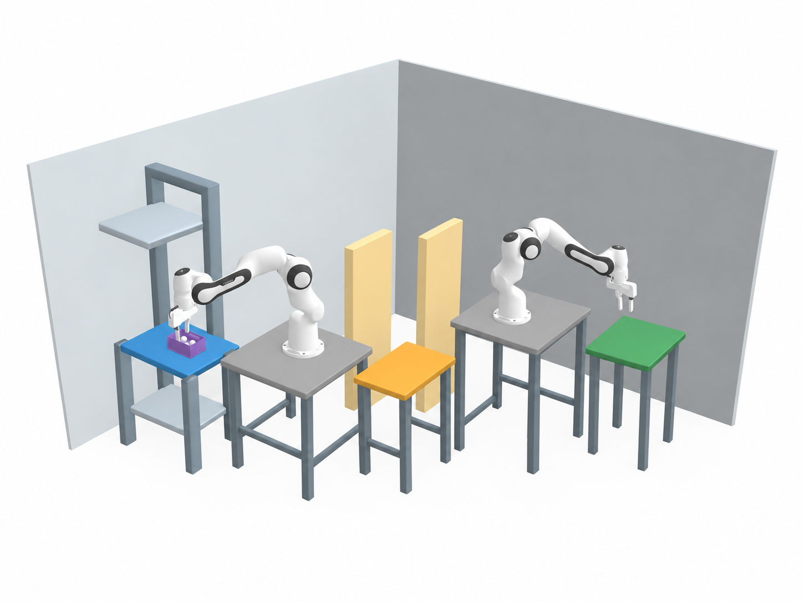
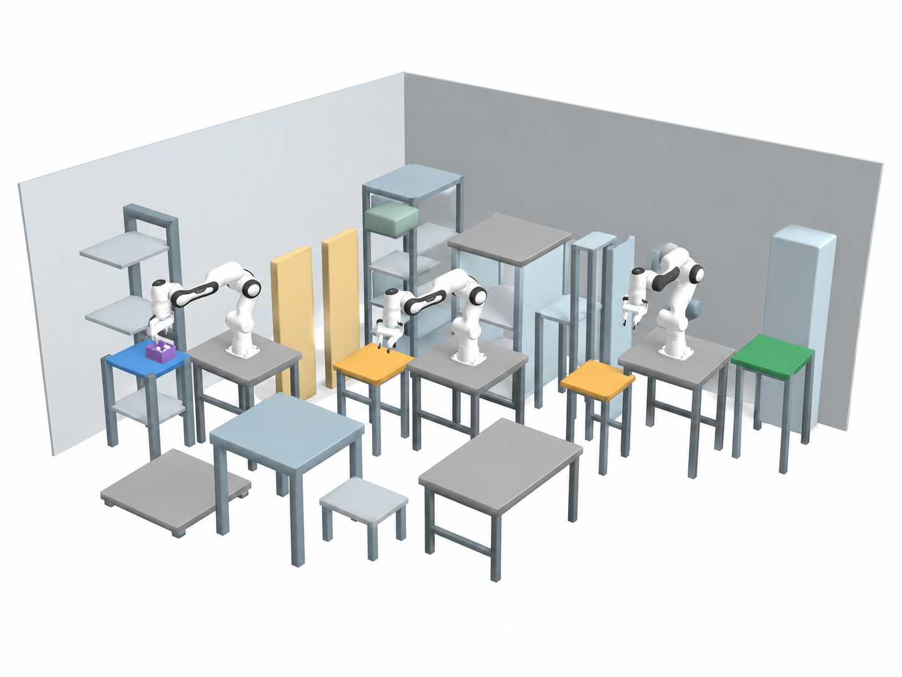

# Project Outline

*Applied Programming · 2026-02 semester*



*Figure 1. Franka Emika Panda sample transport concept, based on the Genesis robot and container. Concept illustration.*

[Project guide](docs/project_outline_with_appendix.pdf) · [Design API](docs/STUDENT_API.md) · [Run and submit](docs/EVALUATION_AND_SUBMISSION.md) · [Leaderboard](https://phoniness-reenact-veggie.ngrok-free.dev)

## 1 Project Background and Task

Physical AI connects computational decisions to physical action. In this project, a robot transports an open cup through a materials-processing cell while respecting equipment and sample constraints. Genesis evaluates how the planned motion affects the robot, container and contents.

Preserve all **four beads** while reducing carrying distance and completion time. Design robot placement, handoff locations, seven-joint paths and speed.

This student package uses **glass beads only**. Process liquid and silica sand remain locked. The supplied bead workflows have been tested on an RTX 4090. Your own design still needs verification. Official bead competition and final representative selection are active. GTX 1660 SUPER runtime and memory remain unmeasured.


| Glass beads | Aqueous solution | Silica sand |
| --- | --- | --- |
| **Open** | **Closed (To be updated)** | **Closed (To be updated)** |



*Concept illustrations from the original Project Outline. The active task uses four glass beads. Aqueous solution and silica sand are not available for execution or scoring.*

### 1.1 Your Implementation

Implement `plan_path` in `student/joint_strategy.py`. Each request gives one arm's exact start and goal configurations. Return at most **10,000 seven-angle configurations** in radians with those exact endpoints, or `None` when the search fails.

Only start and goal configurations are supplied. Generate intermediate configurations using RRT, bidirectional RRT, A*, or another suitable course method. Choose clearance constraints and connection sampling. Final validation resolution stays fixed.



*Figure 2. The student planner constructs the route. A failed search returns None for revision.*

### 1.2 Provided Support

FK, IK, geometry/surface queries, full-robot collision checks, automatic grasp/release and interpolation are provided. The [API guide](docs/STUDENT_API.md) defines exact calls and returns. FK and IK do not establish collision freedom.



*Figure 3. Inputs and outputs of the supplied kinematics helpers. State and connection checks remain separate.*

You do not implement kinematics, a gripping controller, a physics solver or a test harness. Keep the supplied code unchanged. Your work is the planner and permitted design inputs below.

### 1.3 Development Process

Follow the [CPU → optional empty cup → beads workflow](docs/EVALUATION_AND_SUBMISSION.md). Inspect contact, tracking, bead retention and arrival records, then revise the path or permitted settings and export a fresh plan.



*Figure 4. Geometric checks establish route validity at the supplied resolution. Simulation reveals physical transport behavior.*

The same saved CPU path and timing are reused for both physical checks. After editing your planner or design, export a fresh plan. The optional 3D preview shows your own saved motion before physics.

## 2 Layout and Design Conditions

### 2.1 Layout Examples

Compare team size, required handoffs and the **simulated** deadline before choosing a task.

| Complexity | CLI name | Students | Base maximum | Carrying arms / handoffs | Deadline |
| --- | --- | ---: | ---: | ---: | ---: |
| Lower | `easy` | 1 | 80 | 1 / 0 | 40 s |
| Moderate | `medium` | 1–2 | 90 | 2 / 1 | 85 s |
| Higher | `hard` | 2–3 | 100 | 3 / 2 | 105 s |

Lower has wide passages and alternative routes. Moderate adds staggered barriers and a low roof. Higher adds separated mounting regions, overhead obstacles and two handoffs.

All scenes contain three robot models. Unused arms remain parked collision geometry, so every base needs a valid placement.

| Lower complexity | Moderate complexity | Higher complexity |
| --- | --- | --- |
|  |  |  |

*Figure 5. Layout illustrations from the original Project Outline. See the [current map](docs/project-map-overview.png) and [3D viewer](docs/map_viewer.html) for exact geometry and permitted placements.*

Open `docs/map_viewer.html` from your cloned repository in a browser. Keep `motion_preview.js` beside it. Choose your complexity, then use **Preview your design JSON** to inspect selected bases and exact handoff points. Use **Preview your saved motion** to load an exported motion preview, then choose **Stage** and **Frame** to inspect planned joint motion. Use the [map constraints](docs/MAPS_AND_DESIGN.md) when choosing placements.

### 2.2 Design Inputs

Edit these inputs. In filenames, `<tier>` means `easy`, `medium` or `hard`. Replace editable JSON `null` values with your choices. Complete all three base entries and both relay entries, including unused scene entries, while preserving the fixed source and finish.

| Decision | Input and units | Edit location |
| --- | --- | --- |
| Robot placement | Mounting surface, X/Y in m, yaw in rad. Surface choice fixes height. | `student/<tier>_design.json` → `arms` |
| Handoffs | Allowed support ID and landing X/Y in m | Same JSON → `relays` |
| Joint path | A sequence of seven-angle configurations in rad | `student/joint_strategy.py` → `plan_path` |
| Speed | `joint_speed_scale` in (0, 1], or one duration in seconds per path edge | Design JSON or `choose_edge_durations_s` |

### 2.3 Fixed Conditions

Keep the map, source/finish, robot, cup, material and original four beads unchanged. Handoffs never reset or replace beads. Angles must stay within `request.bounds`. Collision checks include the robot, cup, obstacles and other arms.

The supplied interpolator **accelerates and decelerates to rest at every waypoint**. Choose paths and edge durations. You do not implement a braking controller.

| Joints | Maximum absolute velocity | Maximum absolute acceleration/deceleration |
| --- | ---: | ---: |
| 1–4 | 1.0 rad/s | 2.0 rad/s² |
| 5–7 | 1.4 rad/s | 2.8 rad/s² |

These limits apply to commands and actual motion. Tracking error must stay within **0.03 rad**. Physics uses **0.0025 s** intervals and **16 internal substeps**. A legal command can still fail physical replay.

Actual bead loss, prohibited contact, control-limit violations, or failed final support/rest reject a run. There is no separate 8° spill gate or required slowdown multiplier.

After a handoff, the donor follows its reverse path kinematically with **zero physics time**. Only its final pose receives a contact check. This does not certify the return's swept collision freedom. The last carrier does not return.

## 3 Start and Test Your Design

On GitHub, choose **Use this template → Create a new repository**. The course template is public. Create **one private repository per team** for all shared work and final submission. Add every teammate and the instructor account **SSUMechE** as collaborators. Each member must commit and push their own work using their own GitHub account. Keep the team repository private so other teams cannot inspect your designs or paths. Do not post design files, saved paths or motion previews publicly. Save the instructor-issued team token outside Git at `%USERPROFILE%\applied-programming-team.token`.

Use **Windows Anaconda Prompt** and the existing `applied-programming-cuda` environment. Replace the two placeholders with your repository URL and folder name:

```bat
git clone YOUR_PROJECT_REPOSITORY_URL
cd YOUR_PROJECT_REPOSITORY_NAME
conda activate applied-programming-cuda
python -B project_run.py configure --token-file "%USERPROFILE%\applied-programming-team.token"
python -B project_run.py check --cuda --output output/environment.json
```

Continue after `REPORTING_CONFIGURED` and `ENVIRONMENT_CUDA_SMOKE_PASS`. Keep **PyTorch 2.14.0+cu126** and **Genesis 1.3.2**. On an environment mismatch, preserve the output and wait for guidance before changing packages.

Complete your planner and selected design JSON, then run:

```bat
python -B project_run.py test
```

All three supplied interface checks should pass. They do not establish map feasibility or physical success. Follow the **[exact run commands](docs/EVALUATION_AND_SUBMISSION.md)** in this order:

1. Export a full CPU plan to a fresh output folder.
2. Optionally inspect your saved motion in the 3D viewer and replay with an empty cup.
3. Replay that same plan with all four beads.
4. Read the physical result and upload status separately. Revise and re-export after failure.

The run guide gives success markers, failure recovery, optional single-stage CPU debugging and [measured cost guidance](docs/EVALUATION_AND_SUBMISSION.md#interpret-time-and-cost). Previewing does not perform physics or replace collision, contact or bead checks.

## 4 Results, Leaderboard and Submission

Every completed full bead review automatically records success or failure. A full physical pass requires `review_accepted`, `physical_transport_accepted` and `full_mission_passed` all true in `REVIEW_SUPERVISOR.json`. `LEADERBOARD_STATUS.json` separately reports `uploaded` or `pending`.

[Open the leaderboard](https://phoniness-reenact-veggie.ngrok-free.dev). Select your complexity and `term_v3` rule. The live comparison uses each team's latest successful run. A later failure stays in history without replacing that success. Official ranking uses the successful representative each team explicitly selects. Instructor test runs are kept outside the classroom standings.

The public leaderboard shares result summaries, not robot layouts, handoff coordinates, joint paths or student source code. Your detailed attempt history requires your own team token.

The supplied runner reports failed check, test, plan and review commands privately to the instructor. If a connection fails, keep your output and run `python -B project_run.py retry` after reconnecting. This uploads queued results and diagnostics without rerunning Genesis. Students need no ngrok, VPN or bug-report form.

Choose one successful run that matches all submitted student Python/JSON files and select it with the [final-selection command](docs/EVALUATION_AND_SUBMISSION.md#7-select-the-final-representative-and-submit). Confirm `status: selected` with the intended run and full commit ID.

Prepare **one team PowerPoint with 2–3 common slides plus 3 slides per member**, excluding the title. Explain design choices, results and each member's contribution using the actual commit and push history of that shared repository. Submit the repository URL and full **40-character commit ID** in the LMS. The leaderboard does not replace these deliverables. See [assessment and competition](docs/SCORING.md) for the complete scoring rules.


## 5 Updates and Recovery

Use the supplied updater when the instructor announces a fix. It preserves your `student/` work, `output/` records and upload queues, credentials and Git history. It applies verified supplied files from an exact official release and keeps a rollback backup. It does not install packages or run Genesis.

Run `python -B project_run.py update status` to see the installed release. Follow [the update and rollback commands](docs/EVALUATION_AND_SUBMISSION.md#keep-supplied-code-current). That guide also covers the first update from the earlier template. Stop running project commands before applying an update. Local changes to supplied files cause a refusal rather than being overwritten.
