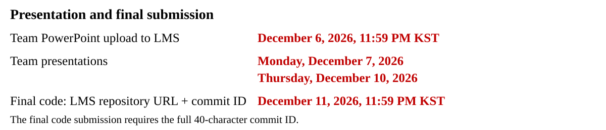

# Test, replay and submit

**2026-02 · Beads only · term_v3**

Design your layout, seven-joint path and speed. Supplied code performs grasping and placement. The exact saved CPU path is reused by empty-cup and bead replay. [Inputs and API](STUDENT_API.md) · [Maps](MAPS_AND_DESIGN.md) · [Scoring](SCORING.md)

The supplied bead workflows have been tested on an RTX 4090. Verify your own layout, path and speed with the steps below. Official bead competition and final representative selection are active. Instructor test records are separate from classroom standings. GTX 1660 SUPER runtime and memory remain unmeasured. Process liquid and silica sand remain locked.

## 1. Register your team and check the environment

First create and clone your team's private repository using [README 3.1](../README.md#31-create-and-clone-your-teams-repository). Use **Windows Anaconda Prompt** from that repository root. Copy commands without prompts or printed output. Connect your team and check the environment now. After choosing a complexity below, implement your planner before running its tests. The first interactive check registers or signs in to your team's account:

```bat
conda activate applied-programming-cuda
python -B project_run.py check --cuda --output output/environment.json
```

Agree on one unique team name and a shared project password of at least **12 characters**. Each teammate enters the same pair once per checkout on each computer. Use a password made for this project, not a GitHub password. Type it only at the hidden prompt. Do not paste it into a command, design file or Git commit.

The supplied client creates the team on first use or signs in to an existing team. On that first successful sign-in, confirm `TEAM_CONNECTED: <your team name>`. Later cached checks reuse the credential without printing that message. The client saves a separate credential for this checkout on this computer outside Git and reuses it automatically. It does not store the password. No instructor-issued token, token-file copying, ngrok or VPN installation is needed. If saved sign-in is refused, run `python -B project_run.py configure` and re-enter the same team password.

If sign-in fails or first use is offline, a `TEAM_SIGN_IN_*` message explains the issue and local check, test, plan and review work can continue. Keep your output. After reconnecting, run `python -B project_run.py retry` to sign in and upload queued records. Unattended commands do not invent a team or wait for interactive input.

The environment check must print `ENVIRONMENT_CUDA_SMOKE_PASS`. Keep the existing PyTorch environment. A mismatch is reported automatically when connected. Wait for instructor guidance before changing packages.

The supplied `project_run.py` runs the original checks, planner and physical evaluator with your arguments. It preserves their exit status and does not change paths, timing or physics. Failed `check`, `test`, `plan` and `review` commands queue a short diagnostic for the instructor, separate from competition records.

## 2. Select your complexity and output folder

Copy one block. These variables last only in the current prompt window.

Lower complexity:

```bat
set "LEVEL=easy"
set "MAP=easy_open_v1"
set "RUN=output\lower_01"
```

Moderate complexity:

```bat
set "LEVEL=medium"
set "MAP=medium_staggered_v1"
set "RUN=output\moderate_01"
```

Higher complexity:

```bat
set "LEVEL=hard"
set "MAP=hard_industrial_v1"
set "RUN=output\higher_01"
```

For another attempt, choose a fresh `RUN`, such as `output\higher_02`. Preserve earlier results.

### Implement the selected design, then test

Complete `student/joint_strategy.py::plan_path` and the selected `student/%LEVEL%_design.json` before planning. Choose `joint_speed_scale` or implement the optional `choose_edge_durations_s` function. The [README edit checklist](../README.md#34-implement-your-planner-and-design) and [API contract](STUDENT_API.md) identify the exact inputs and return values.

After implementing these student inputs, run the supplied checks:

```bat
python -B project_run.py test
```

All three interface checks should pass. The unfinished starter intentionally fails two path checks. These tests check function contracts, not workcell feasibility or physical transport.

## 3. Save a CPU-checked path

```bat
python -B project_run.py plan --scope tier-mission --difficulty %LEVEL% --material beads --task cases/difficulty_20261106/%MAP% --design student/%LEVEL%_design.json --strategy student.joint_strategy --output "%RUN%/cpu"
```

Continue after `CPU_GEOMETRIC_TIER_MISSION_PLANNED`. `%RUN%/cpu/saved_tier_mission.json` contains exact joints, edge durations, layout and source identities. CPU geometry and analytic timing checks do not establish actual velocity/acceleration compliance, bead retention or completion within the simulated deadline. To use your explicit timing function, set JSON speed scale to `1.0` and append `--edge-timing-hook`.

Do not edit planner, design or supplied files between export and replay. After an edit, plan again in a fresh output folder. Default CPU search has no wall timeout. The query budget remains finite.

**Optional: inspect your own saved motion.** After a complete CPU export, create a viewer file:

```bat
python -B export_student_view.py --saved-tier "%RUN%/cpu/saved_tier_mission.json" --output "%RUN%/motion_preview.json"
```

Open `docs/map_viewer.html` from your cloned repository in a browser. Keep `motion_preview.js` beside it. Select the same complexity as your plan and choose **Preview your saved motion**, then load `motion_preview.json`. Use **Stage**, **Frame** or **Play** to inspect the arm, cup, seven joint angles, planned path and chosen handoff coordinates. Use **Preview your design JSON** to inspect base and handoff choices before planning. The preview reads your saved plan without replanning, retiming or starting Genesis. Its stage command time is not the competition completion time. It shows planned collision geometry, not measured physical tracking, bead motion or a new collision certificate. Continue with empty-cup or bead replay for physical verification.

**Optional: diagnose one CPU stage.** If a CPU attempt failed after saving its input records, you may edit `student/joint_strategy.py` and retry just its next stage with the supplied diagnostic tool:

```bat
python -B debug_cpu_stage.py --cpu-dir "%RUN%/cpu" --difficulty %LEVEL% --stage next --plan --output "%RUN%/debug_stage_01"
```

Read `DIAGNOSTIC.json` in that fresh output folder. `DIAGNOSTIC_STAGE_PLANNED` means only that this stage passed CPU path checks. The tool reuses your preceding saved stages, actual selected supports and peer poses. It rejects a changed design, map or supplied source. It creates no replayable mission and never uploads a result. Run the normal full CPU export again before Genesis, even after diagnostic success.

Remove `--plan` to inspect the reconstructed endpoints and direct-edge diagnostic without calling your planner. For a completed attempt, replace `next` with a saved stage ID, such as `arm_0__carry`. Append `--edge-timing-hook` to test your timing function. The diagnostic has a 120-second default wall limit. Inspect `DIAGNOSTIC_PROCESS.json` and `worker_stdout.log` for timeout or interrupted-worker details. A timeout that prevents the worker report produces `DIAGNOSTIC_TIMEOUT`. Use `--wall-limit-s` to choose another positive limit. Completed stages supply the original seed and budgets. If the first stage failed, supply the original `--seed`, `--max-queries` and `--endpoint-attempts` values. Their normal CPU defaults are `71`, `50000` and `32`. Missing or inconsistent records require a fresh normal CPU run. This diagnostic is optional and adds no submission item.

## 4. Optionally replay with an empty cup

```bat
python -B project_run.py review --saved-tier "%RUN%/cpu/saved_tier_mission.json" --difficulty %LEVEL% --task cases/difficulty_20261106/%MAP% --design student/%LEVEL%_design.json --contents empty --output "%RUN%/empty"
```

This uses the same layout, initial robot/cup poses, paths, times and rigid16 settings, with only the beads removed. It checks physical following, contact, handling and completion. It cannot check bead retention and never uploads a competition record. A passing supervisor reports `review_accepted: true` and `empty_mission_passed: true`. Its `full_mission_passed` remains false.

## 5. Replay the full path with beads

```bat
python -B project_run.py review --saved-tier "%RUN%/cpu/saved_tier_mission.json" --difficulty %LEVEL% --task cases/difficulty_20261106/%MAP% --design student/%LEVEL%_design.json --rule leaderboard/rules/term_v3/ap2026-%LEVEL%-beads-term-v3.json --output "%RUN%/full"
```

Genesis replays the saved path without new RRT or online IK. Lower completes one carry, Moderate two and Higher three, using the same cup and four bead IDs. Actual joint velocity/acceleration violations, tracking failure, prohibited contact, bead loss or an unmet final support/rest condition reject the run. The [speed contract](STUDENT_API.md#design-speed) gives the fixed limits and explains automatic acceleration/deceleration. Actual loss stops the run. A lost bead is not regenerated, restored or converted into a competitive partial result.

Inspect `%RUN%/full/REVIEW_SUPERVISOR.json`. Successful full transport requires `review_accepted`, `physical_transport_accepted` and `full_mission_passed` all true. Inspect `%RUN%/full/LEADERBOARD_STATUS.json` separately for upload state.

Every completed full bead review automatically records success or failure. `status: uploaded` means the server acknowledged that attempt. It is not by itself a physics pass. `status: pending` means the local record is queued. `scoring_enabled: false` identifies staging rather than an active competition rule. CPU, empty-cup and short practice runs never enter competition history. Failures from the supplied runner are shared as private diagnostics.

## 6. Retry an upload without repeating Genesis

If the server or team sign-in was unavailable, keep your output and run:

```bat
python -B project_run.py retry
```

This resends pending diagnostics and leaderboard records using your saved team sign-in. Inspect each returned status. An acknowledged duplicate does not create an extra record. This command launches no physics. If a local automatic competition record was not created, recover it from the completed review:

```bat
python -B project_run.py record --rule leaderboard/rules/term_v3/ap2026-%LEVEL%-beads-term-v3.json --review-dir "%RUN%/full"
```

The public leaderboard shows result summaries. It does not publish robot layouts, handoff coordinates, joint paths or student code. Detailed attempts and history require your own team sign-in. Open the [class leaderboard](https://phoniness-reenact-veggie.ngrok-free.dev), or inspect your team's history:

```bat
python -B project_run.py history --rule-id ap2026-%LEVEL%-beads-term-v3
```

The live comparison uses each team's latest successful run. A later failure stays in history and does not replace that success. The official comparison uses the successful run explicitly selected by each team.

## 7. Select the final representative and submit

**Every team submits, even without a successful full mission.** Use the same private team repository, presentation and LMS procedure.

Commit and push the student files you are submitting to the shared team repository using your usual Git workflow, then obtain the full ID:

```bat
git rev-parse HEAD
```

**If you have a successful full run:** choose an acknowledged successful run under your active complexity rule that matches that commit. Replace the placeholder with the exact 40 characters printed above. Set `RUN` to the selected run's folder before this command.

```bat
python -B project_run.py select --review-dir "%RUN%/full" --commit YOUR_FULL_40_CHARACTER_COMMIT_ID
```

Confirm `status: selected`, the intended `run_id` and your full `commit_id` in the response. The command checks every `.py` and `.json` file under `student/`, including helper modules and unused tier designs, against the evaluated snapshot. A changed planner or design cannot be attached to an older result. The instructor freezes official selections for assessment.

**If you have no successful full run:** do not run `select`. Submit your implemented planner and design from that commit. Retain the original available execution records supporting that work. The existing rubric assesses your implementation, design and independently verified completed carries. Failed runs receive no competition adjustment. Submit the same presentation and LMS items below. No extra report or form is required.

Use the **one shared private team repository** created from the public course template for work and final submission. Give every teammate and **SSUMechE** access. Each member must commit and push their own changes using their own GitHub account. Keep design files, saved paths and motion previews private. Prepare one team PowerPoint with **2–3 common slides plus 3 slides per member**, excluding the title slide. Include the repository URL, the full 40-character commit ID used for the presented results, settings, run instructions and relevant execution records. Each member explains their own named contribution using the actual commit and push history, with links to their pushed commits and relevant pull requests. See [assessment details](SCORING.md).



Use the LMS submission field and file-upload area. Posting results only in Comments instead of submitting them in the required field will incur a deduction.

The presentation commit identifies its presented results. The final code submission identifies the final submitted revision. Leaderboard registration does not replace these deliverables.

## Keep supplied code current

Use these maintenance commands from your repository root in **Windows Anaconda Prompt**. Stop **all** project commands first, including direct CPU debugging, preview export and leaderboard commands. Use the existing `applied-programming-cuda` environment. The updater preserves `student/`, saved results, pending uploads, credentials, unknown files and Git history. It changes only verified supplied files. It does not install dependencies, commit changes, plan a path or launch Genesis.

### Check and apply an announced release

Set `RELEASE` to the exact tag announced by the instructor. The current guidance release is shown below:

```bat
set "RELEASE=term-v3-outline-heading-20261114"
python -B project_run.py update check --release "%RELEASE%"
```

`UPDATE_CHECK_PASS` means the official release and your current supplied files passed the update checks. It does not apply files. Read its proposed changes, then apply that same tag:

```bat
python -B project_run.py update apply --release "%RELEASE%"
python -B project_run.py update status
```

`UPDATE_APPLIED` includes a `backup_id`. Keep the backup under `output/project_updates/`. `UPDATE_ALREADY_CURRENT` means no update was needed. `UPDATE_STATUS` reports local release and recovery information. Use `update check` to verify that state against the official release. Your own Python/JSON files and existing result records stay in place.

After an applied update, run the environment check and supplied tests. Review the supplied-file changes with your usual Git workflow and commit them to your team repository. The updater does not stage, commit or push for you. Create a **fresh CPU export** before the next physical replay. Do not edit or relabel older runs. A retry still uploads the original queued record under its original rule.

```bat
python -B project_run.py check --cuda --output output/update_environment.json
python -B project_run.py test
```

If the updater reports `UPDATE_REFUSED`, read its `code` and named paths. `LOCAL_SUPPLIED_FILE_CHANGED` means a supplied file differs from its released version. `UNMANAGED_FILE_COLLISION` means a new supplied file would overwrite another local file. Both stop before overwriting that work. Keep the files and ask the instructor to resolve the conflict. Do not reset your repository or copy a whole new package over it. `UPDATE_BUSY` means another project or maintenance command is running. Let it finish before retrying.

### Restore the supplied files from a backup

If an applied update causes a problem, stop project commands and replace `BACKUP_ID` with the exact ID printed by `UPDATE_APPLIED` or listed by `update status`:

```bat
python -B project_run.py update rollback --backup BACKUP_ID
```

Continue after `UPDATE_ROLLED_BACK`. Rollback restores supplied files only. It preserves student edits made after the update, results and Git history. It refuses to overwrite supplied files that you changed after applying the update. If you had already committed the update, commit the rollback as a new change through your normal Git workflow. Retain the backup and existing run records.

If a maintenance command was interrupted, run `python -B project_run.py update status` before doing project work. The updater first recovers an unfinished file transaction. Ordinary runner commands refuse an unfinished update with `PROJECT_UPDATE_RECOVERY_REQUIRED`. If the main entry point is unavailable during the first migration, use the retained bootstrap file with `python -B "%BOOT%\update_project.py" status`. Recovery uses the local backup and does not need a network connection. Follow any reported recovery error instead of starting a new run.

### First update from the earlier template

Use this block only if `project_run.py update` is unavailable in the original `term-v3-student-20261114` template. Keep your existing team repository. Choose a **fresh** `BOOT` folder name. These commands fetch the exact official tag and save the updater in ignored output storage without replacing your planner or the old runner:

```bat
set "RELEASE=term-v3-outline-heading-20261114"
set "BOOT=output\update_bootstrap_01"
mkdir "%BOOT%" && git fetch --no-tags https://github.com/SSUMechE/applied-programming-2026-term-project.git refs/tags/%RELEASE% && git show FETCH_HEAD:update_project.py > "%BOOT%\update_project.py"
python -B "%BOOT%\update_project.py" check --release "%RELEASE%"
```

Continue only after `UPDATE_CHECK_PASS`, then apply:

```bat
python -B "%BOOT%\update_project.py" apply --release "%RELEASE%"
python -B project_run.py update status
```

The one-time bootstrap fetch updates Git's `FETCH_HEAD`. It does not merge branches, alter your index, replace commits or change your remote URL. Normal updater fetches use their own isolated cache. Keep the bootstrap file. If rollback restores the old runner without an update command, invoke that saved file instead: `python -B "%BOOT%\update_project.py" rollback --backup BACKUP_ID`.

If creating the bootstrap folder or fetching the release failed, stop and preserve the error. Do not run a previously downloaded file by assuming the failed command succeeded. No package reinstall is part of an update.


## Interpret time and cost

Use the simulated deadline to evaluate transport and the computer guard to diagnose resource cost.

| Complexity | Simulated deadline | Default computer review guard |
| --- | ---: | ---: |
| Lower | 40 s | 1,800 s |
| Moderate | 85 s | 3,600 s |
| Higher | 105 s | 5,400 s |

The simulated clock excludes the initial 200 preparation ticks (0.5 s), then includes approach, carrying, handling, waiting and required settling. Deadlines are inclusive. Supplied donor returns reverse their own paths kinematically with zero physics ticks. Only the return's final home pose receives a contact check. This display operation does not certify swept collision freedom or simulate physical return motion. The final carrier does not return.

Computer cost is measured separately. CPU records distinguish total elapsed time, student search callback time and remaining validation/export attribution. The review guard includes the attributed CPU work, GPU review, monitoring, export and cleanup. Search time remains reported but is excluded from that guard. A guard is not a runtime estimate. Missing memory measurements do not count as zero. Sampled process VRAM must stay within 5,000,000,000 bytes. GTX 1660 SUPER costs remain unqualified until measured on that hardware.

A measured **Lower** example on the instructor's **RTX 4090** took **20 min 17.289 s** for configuration, CUDA check, three tests, fresh CPU planning, full bead review and HTTPS registration. CPU planning took **22.308 s** and the native review took **19 min 40.741 s**. This is one completed design, not a guaranteed duration or a GTX 1660 estimate. Different paths, speeds, initialization/cache states and hardware change the cost. The native review includes preparation, physics, checks and recording. It is not a pure GPU-kernel measurement.

## Resolve failures

Use the first reported failure to choose an action. The supplied runner automatically sends a bounded error summary, execution stage, command settings, environment versions and source hashes to the instructor's private issue view. It separates design failures from program or environment errors. It does not upload student source code, credentials or full logs. Reporting does not change the result or score.

`Diagnostic uploaded` confirms that the report reached the instructor. `Diagnostic pending` means it remains in `output/diagnostics_queue`. The instructor can see it after upload, not while the computer is offline. The next supplied-runner command retries pending reports. You can also use `python -B project_run.py retry` after reconnecting. Keep the original local records for detailed debugging. There is no separate bug-report form.

| Result | Next action |
| --- | --- |
| `NotImplementedError` or unset design | Complete the named student function or JSON choice |
| Fresh-directory error | Choose a new `RUN` or output subfolder |
| CPU search or endpoint failure | Inspect the stage, layout and query diagnostics |
| Source mismatch | Restore supplied files and re-export your edited student design |
| `control:acceleration_limit` | Locate the failed phase and tick below. Increase relevant edge durations or revise the path, then create a fresh CPU export |
| Contact, loss or tracking failure | Revise the path, placement or speed and re-export |
| Pending upload | Retry the queued record without rerunning Genesis |
| Final selection mismatch | Select a run whose evaluated student files match the submitted commit |

For a control rejection during an approach or carry, `%RUN%/full/REVIEW_SUPERVISOR.json` gives `worker_failure.message`. Open `%RUN%/full/device_tier_execution/TIER_DEVICE_RESULT.json` and read `failed_phase_prefix.purpose` for the stage. Inside that prefix, `checks.checks.control.flags` identifies the failed condition and `checks.checks.control.first_failed_step` gives its native tick. The stage elapsed time is `(first_failed_step - stage_start_tick) * 0.0025`. Use the prefix's `start_native_step` as `stage_start_tick`, unless earlier entries in `phases` have the same `purpose`. For a stage split into chunks, use the first such entry's `start_native_step`. Compare the elapsed time with the matching saved stage's `trajectory.waypoint_times_s` to locate the commanded edge. These JSON fields require no new analysis script.

Deceleration is already supplied. Changing the relevant duration in `choose_edge_durations_s`, reducing JSON speed scale, or revising the path changes the saved command. A longer duration is a design choice, not a guaranteed cure for physical contact or control failure. No prescribed multiplier or hidden replay retiming applies. Keep the fixed limits and re-export after each student-input edit.

Retain original records, including failed attempts. Supplied checks and source matching establish reproducibility boundaries, not remote attestation of a student-controlled computer.
