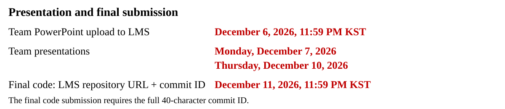
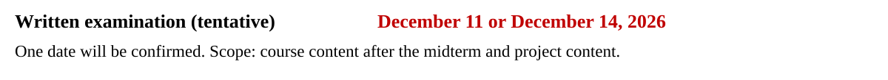

# Assessment and competition

**2026-02 · Beads only · term_v3**

The base assessment rewards your implemented design and valid transport. Competition separately compares successful teams' carried distance and completion time. Analysis is assessed in the existing presentation component, not a new report or extra base category. The three term_v3 bead rules are active. Instructor qualification records remain separate from classroom standings.

## Base assessment

Choose a permitted team size and complexity. Let `M` be its base maximum.

| Complexity | Team size | Required carries | M |
| --- | ---: | ---: | ---: |
| Lower | 1 | 1 | 80 |
| Moderate | 1–2 | 2 | 90 |
| Higher | 2–3 | 3 | 100 |

The maximum is not an automatic award. Apply these criteria to the submitted student implementation and its matching records.

| Component | Maximum | Evidence and assessed work |
| --- | ---: | --- |
| Path implementation | 20% of M | Valid state/edge selection, route recovery and sensible search failure/query handling in `plan_path` |
| Layout, handoffs and geometric constraints | 20% of M | Permitted bases and relays, use of geometry/clearance, and how the choices affect reachability or interference |
| Speed design | 10% of M | Valid speed scale or edge times and their connection to the chosen motion |
| Valid transport completion | 50% of M | Verified complete carries divided by the required 1, 2 or 3 carries |

A valid carry includes its verified arrival, retained beads and supported release/rest. A partial path through a carry earns no fraction of that carry. Later failure does not erase earlier independently verified carries. Missing or unusable evidence is marked unknown for review, not invented as a measured zero. An incomplete run cannot enter the competition ranking.

For multi-person teams, the instructor adjusts each member's base by −5 to +5 for actual code contribution. A solo contribution adjustment is 0. Clamp the adjusted base to `[0, M]`. Then add the competition adjustment and presentation adjustment, with a final floor of 0.

For example, a Moderate team earning 30 of the 50 normalized design points and completing one of two valid carries has `90 × (30/100 + 0.5 × 1/2) = 49.5` base points before contribution adjustment.

## Distance and time

`D` is the actual cup-centre travel distance while a robot holds the cup, summed over physical outer steps. The board stores it in whole millimetres. It includes motion during held waits or handling. It excludes unheld approach, released settling and the supplied zero-time donor return. It is not joint-space distance in radians or the length of the planned tool path.

`T` is the verified completion clock in native `0.0025 s` ticks. It excludes the initial 200 preparation ticks and includes physical approach, carry, handling, waiting and required settling. The fixed inclusive limits are 40 s, 85 s and 105 s for Lower, Moderate and Higher.

For each complexity and active rule, compare one successful representative per team. A solo entry is one team. With that population's minima and maxima:

```text
Dn = (D - Dmin) / (Dmax - Dmin)
Tn = (T - Tmin) / (Tmax - Tmin)
C  = 0.5 * Dn + 0.5 * Tn
```

Lower `C` ranks higher. A metric with no variation contributes 0 for every team. The other weight remains 0.5. The server uses exact rational arithmetic for ties. Equal composites share rank, such as 1, 1, 3. Upload order and computer speed do not break ties.

The live board uses each team's latest successful run. New successful results can change the population's ranges and every displayed composite. Official assessment uses each team's explicitly selected successful run after the instructor freezes selection. A later failure remains in history and does not replace a success.

## Competition adjustment

Use the row for your complexity after ranking the successful representatives.

| Complexity | Rank 1 | Rank 2 | Rank 3 |
| --- | ---: | ---: | ---: |
| Lower | +5 | +3 | +1 |
| Moderate | +10 | +5 | +3 |
| Higher | +15 | +10 | +5 |

Let `N` be the number of successful representatives. Fourth place receives 0. If `N >= 5`, lower ranks receive:

```text
A(C) = -N * (C - C4) / (Cmax - C4)
```

`C4` is the composite of the fourth entry in sorted order, including ties. `Cmax` is the population's largest composite. If these are equal, every lower-rank adjustment is 0. With only four teams, fourth place also receives 0. For six teams with `C4 = 0.50` and `Cmax = 1.00`, composites 0.50, 0.75 and 1.00 give 0, −3 and −6 points. Failed runs receive no competition adjustment and are not part of `N`.

## Presentation and submission

Prepare **one team PowerPoint with 2–3 common slides plus 3 slides per member**. The title slide is excluded. Each member presents their named section. This gives 5–6, 8–9 or 11–12 content slides for teams of one, two or three.

The common part explains the mission, method, constraints, route and speed choices, results and interpretation. Include the shared private repository URL, the full 40-character commit ID used for the presented results, case/settings and reproduction instructions. Each member identifies their role, changed files/functions, key code, effect on results and links to their pushed commits and relevant pull requests. Explain each person's contribution to joint work using the actual commit and push history.

Presentation contributes −10 to +10 after the base ceiling: shared team quality from −5 to +5, plus individual presentation from −5 to +5. Both apply to solo students too.

Each of the five team criteria and five individual criteria below receives **−1, 0 or +1**. Add the five team scores for the shared **−5 to +5** adjustment. Add each member's five individual scores for that member's **−5 to +5** adjustment. The two adjustments total **−10 to +10**. Both apply to solo students.

Use these anchors for each criterion:

- **−1:** The required explanation is absent, materially incorrect or unsupported by the available code and records.
- **0:** The explanation is accurate, clear and traceable to the relevant code, settings or records.
- **+1:** The explanation adds evidence-backed causal reasoning or a meaningful, justified tradeoff appropriate to that criterion.

Use the team table to organize the common part of the presentation. It identifies what the existing team-quality adjustment evaluates.

| Team criterion | What to explain |
| --- | --- |
| Mission and fixed constraints | The chosen task and the fixed conditions governing valid transport. |
| Layout and handoff reasoning | Placement and relay choices, reachability, clearance and interference. |
| Search and speed choices | The search method, connection checks, path recovery and chosen speed or edge times. |
| Traceable results and settings | The code revision, case/settings and supplied records supporting the shown outcomes. Make the conditions of any comparison identifiable. |
| Interpretation and limitations | What successes or failures show, the relevant tradeoffs and the limits of the conclusions. |

Use the individual table for each member's existing three-slide part. It evaluates technical explanation of that person's work, including clearly attributed joint work.

| Individual criterion | What to explain |
| --- | --- |
| Actual role and attribution | Own role, edited files/functions and relevant commit links. Identify each person's part in joint work. |
| Core code and search logic | How the relevant core code and search logic work. |
| Reasons for choices | Why the implementation or design choices were made. |
| Effects, debugging and results | How changes and debugging observations connect to the observed results. |
| Structured technical explanation | A coherent, precise account using correct terms and traceable code or result references. |

Use the code and records already produced for the project. No new experiment count, test authorship, report or form is required. Accurate analysis of failed runs can earn strong presentation marks. Commit counts, line counts, slide decoration and the presence of a video earn no points by themselves. The separate code-contribution adjustment evaluates actual work. Presentation evaluates the explanation and its supporting code and records.

**Submission without a full success:** every team submits its implemented code/design, the same presentation, and the repository URL plus full commit ID in the LMS. If there is no successful full run, do not run `select`. Retain the original available execution records supporting the submitted work. Implementation, design and independently verified completed carries remain assessable under the base rubric. Failed runs receive no competition adjustment. No extra report or form is required.

Use **one shared private repository** for the team's work and submission. Give all members and **SSUMechE** access. Each member must commit and push their own work from their own GitHub account. Retain code/settings and supplied run records supporting the presentation. Select the successful representative using [the run guide](EVALUATION_AND_SUBMISSION.md#7-select-the-final-representative-and-submit). The instructor freezes selections for assessment.



Use the LMS submission field and file-upload area. Posting results only in Comments instead of submitting them in the required field will incur a deduction.

The presentation commit identifies the results shown in that presentation. The final code submission identifies the final submitted revision. No extra student form or verification report is required.


